# Scalable LLM Serving Architecture with vLLM

## 1. Executive Summary & Design Principles

Deploying large language models (LLMs) at enterprise scale requires optimizing both **latency** (Time to First Token - TTFT, Time per Output Token - TPOT) and **throughput** (tokens/sec per GPU, request concurrency). Standard naive serving engines fail due to static batching inefficiencies, KV cache memory fragmentation, and GPU underutilization.

This document details an end-to-end, production-grade, highly available, and scalable LLM serving architecture leveraging **vLLM** as the core inference engine. The design incorporates **PagedAttention**, **Continuous Batching**, **Prefix Caching**, **Speculative Decoding**, **Cache-Aware Routing**, and **KEDA-driven Autoscaling** to handle over 10,000 requests per minute with low latency and maximum hardware cost-efficiency.

### Key Architectural Principles
1. **Decoupled Gateway & Router Layer**: Disconnect client network termination, authentication, guardrails, and routing logic from physical inference hardware.
2. **Cache-Aware Intelligent Routing**: Direct incoming requests to vLLM worker replicas holding hot prefix caches (system prompts, context histories) to achieve up to 80% reduction in prefill computation.
3. **Zero-Fragmentation KV Memory Allocation**: Leverage vLLM's PagedAttention virtual memory block allocation to eliminate 95%+ of GPU memory waste.
4. **Asynchronous Micro-Batch Co-scheduling**: Utilize Chunked Prefill to mix compute-bound prefill requests with memory-bound decode requests without causing token delivery jitter.
5. **Dynamic Kubernetes Autoscaling (KEDA)**: Auto-scale worker pods based on real-time vLLM engine signals (KV cache usage, queue waiting length) rather than CPU/memory metrics.

---

## 2. System Requirements & SLIs/SLOs

| Category | Parameter | Target Metric / Requirement |
| :--- | :--- | :--- |
| **Throughput** | Request Rate | 10,000+ Requests/Min peak capacity |
| **Latency** | Time to First Token (TTFT) | $\le 150 \text{ ms}$ (P95), $\le 300 \text{ ms}$ (P99) |
| **Latency** | Time per Output Token (TPOT) | $\le 25 \text{ ms/token}$ ($\ge 40 \text{ tokens/sec}$ per stream) |
| **Availability** | Multi-AZ Uptime | 99.99% Uptime with automated zone failover |
| **Concurrency** | Active Streaming Streams | 2,500+ parallel concurrent generations |
| **Efficiency** | GPU Memory Utilization | $\ge 90\%$ effective allocation (PagedAttention) |
| **Prefix Reuse**| Cache Hit Ratio | $\ge 60\%$ prefill speedup for system prompts |

---

## 3. High-Level Architecture Overview

The system architecture is structured into 5 distinct tiers: Ingress Gateway, Guardrail/Safety Filter, Cache-Aware LLM Router, vLLM Worker Pool (with KEDA Autoscaler), and Observability Stack.

```mermaid
graph TD
    User[Clients / Apps / Mobile] -->|HTTPS / WSS / gRPC| Ingress[API Gateway - Kong / Envoy]
    
    subgraph Edge & Security Tier
        Ingress --> Auth[Auth & Rate Limiting]
        Auth --> Guardrail[Guardrails Middleware - LlamaGuard / NeMo]
        Guardrail --> SemanticCache[Redis Semantic Prompt Cache]
    end
    
    SemanticCache -->|Cache Miss| Router[Intelligent Cache-Aware LLM Router]
    SemanticCache -->|Cache Hit| User
    
    subgraph Control & Routing Tier
        Router -->|Prometheus Metrics Polling| MetricsEngine[vLLM Metrics Collector]
        Router -->|Prefix Hashing & Load Balancer| ClusterManager[Worker Registry & Health Checker]
    end

    subgraph Scalable Compute Tier - vLLM Cluster
        Router -->|HTTP / gRPC Stream| Worker1[vLLM Pod 1 - GPU Node 1<br/>8x H100 - TP=8]
        Router -->|HTTP / gRPC Stream| Worker2[vLLM Pod 2 - GPU Node 2<br/>8x H100 - TP=8]
        Router -->|HTTP / gRPC Stream| WorkerN[vLLM Pod N - GPU Node N<br/>8x H100 - TP=8]
        
        Worker1 --- ModelStore[(S3 / NVMe Distributed Model Cache)]
        Worker2 --- ModelStore
        WorkerN --- ModelStore
    end
    
    subgraph Autoscaling & Storage Tier
        KEDA[KEDA Autoscaler Controller] -->|Query Metrics| Prometheus[Prometheus Monitoring]
        Prometheus <--|Scrape Metrics| Worker1
        Prometheus <--|Scrape Metrics| Worker2
        Prometheus <--|Scrape Metrics| WorkerN
        KEDA -->|Scale Replicas| ComputeCluster[Kubernetes HPA / GPU Node Pool]
    end
```

---

## 4. In-Depth Component Architecture

### 4.1 Ingress Gateway & Safety Tier
- **API Gateway (Kong / Envoy)**: Handles TLS termination, OAuth2/JWT authentication, per-API-key rate limiting (token bucket algorithm), and CORS headers.
- **Guardrail Service**: Asynchronous pre-execution guardrail evaluating inputs for prompt injection, PII leakages, toxic intent, and compliance violations using lightweight classifier models (e.g., Llama-Guard-3-1B).
- **Redis Semantic Cache**: Stores vector embeddings of previous query-response pairs. If cosine similarity between incoming prompt and stored vector exceeds threshold ($\ge 0.96$), returns cached response instantly (sub-10ms response).

### 4.2 Intelligent Cache-Aware LLM Router
Standard round-robin or least-connections load balancers are suboptimal for LLM inference because they ignore GPU KV cache state. The custom **LLM Router** maintains:
1. **Radix Tree / Prefix Cache Hash Table**: Maps prompt prefix hashes to specific vLLM worker replicas. If a request shares a system prompt or context window with previous requests sent to Worker 2, the router routes to Worker 2 to hit local KV cache.
2. **Real-time Worker Load Score**: Evaluates worker node state using two real-time metrics:
   $$\text{Score}_i = w_1 \cdot \text{PendingRequests}_i + w_2 \cdot \text{GpuKvCacheUsage}_i - w_3 \cdot \text{PrefixCacheHitEstimate}_i$$
3. **Active Health Monitoring & Circuit Breaking**: Automatically removes workers experiencing high hardware error rates (e.g., CUDA OOMs or Xid errors) or high queue latencies.

### 4.3 Scalable vLLM Inference Engine (Worker Cluster)
Each worker runs vLLM inside a containerized Kubernetes Pod with direct access to dedicated GPU hardware (e.g., 8x NVIDIA H100 80GB GPUs over NVSwitch).
- **Tensor Parallelism (TP)**: Splits individual matrix multiplication ops across GPUs within a single node ($TP=8$).
- **Pipeline Parallelism (PP)**: Splits layers across nodes for models exceeding single-node memory (e.g., DeepSeek-V3 or Llama-3.1-405B).
- **Multi-LoRA Serving**: Serves hundreds of fine-tuned domain-specific LoRA adapters on top of a single frozen base model in a single vLLM process.

---

## 5. Deep-Dive vLLM Optimization Mechanisms

### 5.1 PagedAttention & Memory Allocation Mathematics

In standard Transformers, Key-Value (KV) cache memory is allocated statically for the maximum sequence length ($L_{\max}$), causing up to **60-80% memory waste** due to internal fragmentation, external fragmentation, and over-allocation.

vLLM's **PagedAttention** addresses this by dividing the KV cache into fixed-size physical blocks (e.g., 16 tokens per block). Virtual block tables map logical tokens to non-contiguous physical GPU RAM blocks.

#### Memory Requirement Formula
For a model with $L$ layers, $H_{kv}$ key-value heads, head dimension $d_{head}$, precision bytes $P$ (FP16 = 2, FP8 = 1), sequence length $S$, and batch size $B$:

$$\text{KV Cache Memory (Bytes)} = 2 \times L \times H_{kv} \times d_{head} \times P \times S \times B$$

#### Example Calculation: Meta Llama-3.1-70B (FP16, 128k Context Window)
- $L = 80$ layers
- $H_{kv} = 8$ heads (Grouped-Query Attention with 8 KV heads)
- $d_{head} = 128$
- $P = 2$ bytes (FP16)
- Block size = 16 tokens

$$\text{KV Cache Bytes per Token} = 2 \times 80 \times 8 \times 128 \times 2 = 327,680 \text{ Bytes/token} \approx 320 \text{ KB/token}$$

For a single full 128k token context window:
$$\text{Memory per Sequence} = 131,072 \times 320 \text{ KB} \approx 41.94 \text{ GB}$$

With PagedAttention:
- No pre-allocation required. Memory is allocated on-demand in 16-token increments ($16 \times 320 \text{ KB} = 5.12 \text{ MB}$ per block).
- Eliminates 96% of unallocated memory waste, allowing batch size $B$ to scale up by **3x to 4x**.

---

### 5.2 Continuous Batching vs. Static Batching

- **Static Batching**: Waits for $N$ requests to arrive, batches them, runs prefill, and decodes until all sequences finish. Early-terminating sequences leave idle padding tokens.
- **Continuous Batching (Iteration-level Scheduling)**: Operates at individual token generation step granularity. New incoming requests join the batch at the next iteration immediately after their prefill step, while completed sequences leave the batch immediately.

```
Iteration  1: [Req A (Prefill)]  [Req B (Decode)]   [Req C (Decode)]
Iteration  2: [Req A (Decode)]   [Req B (Decode)]   [Req D (Prefill)]
Iteration  3: [Req A (Decode)]   [Req E (Prefill)]  [Req D (Decode)]
```

---

### 5.3 Prefix Caching & Radix Tree Scheduling

When prompt prefixes (such as standard enterprise system prompts, document contexts in RAG, or multi-turn conversational history) are repeated across requests:
- vLLM retains KV cache blocks corresponding to common token sequences in a **Radix Tree**.
- If a new request arrives with a matching prefix, vLLM reuses the existing physical KV cache blocks without recomputing prefill attention tensor operations.
- **Impact**: Reduces Prefill Latency (TTFT) by up to **85%** and drastically lowers FLOP requirements on prefill passes.

---

### 5.4 Chunked Prefill

Long prefill phases (e.g., 32k context prompts) require intensive GPU compute and stall ongoing output decode iterations for existing streaming requests, causing noticeable spikes in TPOT (jitter).

- **Chunked Prefill** (`--enable-chunked-prefill`): Breaks large prefill requests into smaller chunks (e.g., 512 tokens).
- vLLM co-schedules prefill chunks alongside decode steps in the same iteration, capping total execution time per iteration and enforcing a deterministic TTFT/TPOT boundary.

---

### 5.5 Speculative Decoding & Quantization Strategy

#### Speculative Decoding
- Uses a fast, small **Draft Model** (e.g., Llama-3.2-1B) to speculate $K$ target tokens ahead.
- The larger **Target Model** (e.g., Llama-3.1-70B) runs a single parallel validation forward pass over all $K$ tokens.
- Accepts valid tokens based on modified rejection sampling. Yields **2.0x - 2.8x speedup** in TPOT without quality loss.

#### Quantization Matrix
| Method | Weight Precision | KV Cache Precision | Speedup | Perplexity Loss | Hardware Requirement |
| :--- | :--- | :--- | :--- | :--- | :--- |
| **Unquantized (BF16)** | 16-bit | 16-bit | 1.0x (Baseline) | 0.00 (Exact) | NVIDIA A100 / H100 |
| **FP8 (vLLM Native)** | 8-bit | 8-bit (`--kv-cache-dtype fp8`) | 1.8x - 2.2x | < 0.01 (Negligible)| NVIDIA H100 / Ada / L40S |
| **AWQ (Activation-aware)**| 4-bit | 16-bit / 8-bit | 2.5x - 3.2x | < 0.05 | NVIDIA A10G / A100 / H100 |

---

## 6. Infrastructure & Kubernetes Deployment (KEDA Autoscaling)

### Scaling Metric Strategy
Traditional horizontal pod autoscalers (HPA) rely on CPU or standard GPU utilization metrics. However, GPU compute can show 100% utilization even when requests are queuing up endlessly, or show low utilization during memory-bound decoding.

**Recommended Autoscaling Metrics (via KEDA & Prometheus)**:
1. `vllm:num_requests_waiting`: Requests queued waiting for KV cache allocation. Target average: $\le 2.0$.
2. `vllm:gpu_cache_usage_perc`: Percentage of allocated KV blocks. Scale up trigger: $> 85\%$ for $\ge 30 \text{ seconds}$.

```mermaid
graph LR
    Prometheus[Prometheus Metrics] -->|Exposes vllm:num_requests_waiting| KEDA[KEDA ScaledObject Controller]
    KEDA -->|Calculates Desired Replicas| HPA[Kubernetes HPA Target]
    HPA -->|Provisions Pods| WorkerPool[vLLM Worker StatefulSet]
    WorkerPool -->|Triggers Node Allocation| Karpenter[Karpenter / Cluster Autoscaler]
    Karpenter -->|Provisions Cloud GPU Nodes| Cloud[AWS g5 / p5 / GCP A3 Instances]
```



---

## 7. Production vLLM Kubernetes Manifests & Configuration

### 7.1 vLLM Worker Deployment Manifest (`vllm-deployment.yaml`)

```yaml
apiVersion: apps/v1
kind: Deployment
metadata:
  name: vllm-llama3-70b
  namespace: llm-serving
  labels:
    app: vllm-inference
    model: llama-3.1-70b
spec:
  replicas: 2
  selector:
    matchLabels:
      app: vllm-inference
      model: llama-3.1-70b
  template:
    metadata:
      labels:
        app: vllm-inference
        model: llama-3.1-70b
      annotations:
        prometheus.io/scrape: "true"
        prometheus.io/port: "8000"
        prometheus.io/path: "/metrics"
    spec:
      containers:
      - name: vllm-container
        image: vllm/vllm-openai:v0.6.3
        imagePullPolicy: IfNotPresent
        command: ["python3", "-m", "vllm.entrypoints.openai.api_server"]
        args:
        - "--model=/models/Meta-Llama-3.1-70B-Instruct"
        - "--served-model-name=llama-3.1-70b"
        - "--tensor-parallel-size=8"
        - "--gpu-memory-utilization=0.92"
        - "--max-num-seqs=256"
        - "--max-model-len=16384"
        - "--enable-prefix-caching"
        - "--enable-chunked-prefill"
        - "--max-num-batched-tokens=4096"
        - "--kv-cache-dtype=auto"
        - "--trust-remote-code"
        - "--port=8000"
        ports:
        - containerPort: 8000
          name: http
        resources:
          limits:
            nvidia.com/gpu: "8"
            memory: "320Gi"
            cpu: "64"
          requests:
            nvidia.com/gpu: "8"
            memory: "256Gi"
            cpu: "32"
        volumeMounts:
        - mountPath: /models
          name: model-volume
        - mountPath: /dev/shm
          name: dshm
        readinessProbe:
          httpGet:
            path: /health
            port: 8000
          initialDelaySeconds: 120
          periodSeconds: 10
        livenessProbe:
          httpGet:
            path: /health
            port: 8000
          initialDelaySeconds: 180
          periodSeconds: 15
      volumes:
      - name: model-volume
        persistentVolumeClaim:
          claimName: model-pvc-nvme
      - name: dshm
        emptyDir:
          medium: Memory
          sizeLimit: 64Gi
      nodeSelector:
        node.kubernetes.io/instance-type: p5.48xlarge # 8x NVIDIA H100
---
apiVersion: v1
kind: Service
metadata:
  name: vllm-service
  namespace: llm-serving
  labels:
    app: vllm-inference
spec:
  type: ClusterIP
  ports:
  - port: 8000
    targetPort: 8000
    name: http
  selector:
    app: vllm-inference
```

---

### 7.2 KEDA ScaledObject Manifest (`keda-scaledobject.yaml`)

```yaml
apiVersion: keda.sh/v1alpha1
kind: ScaledObject
metadata:
  name: vllm-keda-autoscaler
  namespace: llm-serving
spec:
  scaleTargetRef:
    apiVersion: apps/v1
    kind: Deployment
    name: vllm-llama3-70b
  minReplicaCount: 2
  maxReplicaCount: 16
  cooldownPeriod: 300
  pollingInterval: 15
  advanced:
    horizontalPodAutoscalerConfig:
      behavior:
        scaleUp:
          stabilizationWindowSeconds: 0
          policies:
          - type: Percent
            value: 100
            periodSeconds: 15
        scaleDown:
          stabilizationWindowSeconds: 300
          policies:
          - type: Percent
            value: 10
            periodSeconds: 60
  triggers:
  - type: prometheus
    metadata:
      serverAddress: http://prometheus-k8s.monitoring.svc.cluster.local:9090
      metricName: vllm_num_requests_waiting
      query: sum(vllm:num_requests_waiting{namespace="llm-serving"}) / count(vllm:num_requests_waiting{namespace="llm-serving"})
      threshold: '3.0'
  - type: prometheus
    metadata:
      serverAddress: http://prometheus-k8s.monitoring.svc.cluster.local:9090
      metricName: vllm_gpu_cache_usage_perc
      query: avg(vllm:gpu_cache_usage_perc{namespace="llm-serving"})
      threshold: '0.85'
```

---

## 8. Reference Implementation: Python Intelligent Cache-Aware Router

The following production-ready Python service uses **FastAPI** and **`httpx`** to hash request system prompts, track active worker load, and proxy streaming responses to the optimal vLLM worker node.

```python
import hashlib
import json
import logging
import asyncio
from typing import Dict, List, Optional
from fastapi import FastAPI, Request, HTTPException
from fastapi.responses import StreamingResponse
import httpx

logging.basicConfig(level=logging.INFO)
logger = logging.getLogger("LLMRouter")

app = FastAPI(title="Cache-Aware LLM Router")

# Registered vLLM Worker Endpoints
WORKERS: List[str] = [
    "http://vllm-pod-0.vllm-service.llm-serving.svc.cluster.local:8000",
    "http://vllm-pod-1.vllm-service.llm-serving.svc.cluster.local:8000",
]

# State tracking for routing
worker_metrics: Dict[str, Dict] = {
    w: {"active_requests": 0, "gpu_cache": 0.0, "waiting_queue": 0, "healthy": True}
    for w in WORKERS
}

# Prefix hash mapping to prefer locality
prefix_cache_map: Dict[str, str] = {}
client = httpx.AsyncClient(timeout=httpx.Timeout(60.0, connect=5.0))


def compute_prefix_hash(messages: List[Dict[str, str]]) -> Optional[str]:
    """Extracts system prompt and early context to generate a routing hash key."""
    system_content = ""
    for msg in messages:
        if msg.get("role") in ["system", "developer"]:
            system_content += msg.get("content", "")
    
    if not system_content and messages:
        # Fallback to first user message prefix if system prompt is absent
        system_content = messages[0].get("content", "")[:256]
        
    if not system_content:
        return None
        
    return hashlib.sha256(system_content.encode("utf-8")).hexdigest()


async def poll_worker_health():
    """Background task polling vLLM worker metrics for health and load balancing."""
    while True:
        for worker in WORKERS:
            try:
                resp = await client.get(f"{worker}/metrics", timeout=2.0)
                if resp.status_code == 200:
                    lines = resp.text.split("\n")
                    waiting = 0
                    cache_used = 0.0
                    for line in lines:
                        if line.startswith("vllm:num_requests_waiting"):
                            waiting = int(float(line.split()[-1]))
                        elif line.startswith("vllm:gpu_cache_usage_perc"):
                            cache_used = float(line.split()[-1])
                    
                    worker_metrics[worker]["waiting_queue"] = waiting
                    worker_metrics[worker]["gpu_cache"] = cache_used
                    worker_metrics[worker]["healthy"] = True
                else:
                    worker_metrics[worker]["healthy"] = False
            except Exception as e:
                logger.warning(f"Worker health check failed for {worker}: {e}")
                worker_metrics[worker]["healthy"] = False
        await asyncio.sleep(5)


@app.on_event("startup")
async def startup_event():
    asyncio.create_task(poll_worker_health())


def select_best_worker(prefix_hash: Optional[str]) -> str:
    """Selects worker based on Prefix Cache Locality + Least Load algorithm."""
    healthy_workers = [w for w in WORKERS if worker_metrics[w]["healthy"]]
    if not healthy_workers:
        raise HTTPException(status_code=503, detail="No healthy vLLM worker nodes available.")

    # 1. Prefix Cache Match
    if prefix_hash and prefix_hash in prefix_cache_map:
        cached_worker = prefix_cache_map[prefix_hash]
        if cached_worker in healthy_workers:
            # Route to cached worker if not severely overloaded
            if worker_metrics[cached_worker]["gpu_cache"] < 0.90 and worker_metrics[cached_worker]["waiting_queue"] < 5:
                logger.info(f"Prefix cache hit! Routing to {cached_worker}")
                return cached_worker

    # 2. Least Load Score Algorithm
    # Score = ActiveRequests * 2.0 + WaitingQueue * 3.0 + GpuCache * 10.0
    def score_worker(w: str) -> float:
        m = worker_metrics[w]
        return (m["active_requests"] * 2.0) + (m["waiting_queue"] * 3.0) + (m["gpu_cache"] * 10.0)

    selected = min(healthy_workers, key=score_worker)
    
    # Store prefix mapping for future requests
    if prefix_hash:
        prefix_cache_map[prefix_hash] = selected
        
    return selected


@app.post("/v1/chat/completions")
async def proxy_chat_completions(request: Request):
    body = await request.json()
    messages = body.get("messages", [])
    prefix_hash = compute_prefix_hash(messages)
    
    target_worker = select_best_worker(prefix_hash)
    worker_metrics[target_worker]["active_requests"] += 1

    req_headers = dict(request.headers)
    req_headers.pop("host", None)

    async def stream_generator():
        try:
            url = f"{target_worker}/v1/chat/completions"
            async with client.stream("POST", url, json=body, headers=req_headers) as response:
                if response.status_code != 200:
                    error_text = await response.aread()
                    yield error_text
                    return
                
                async for chunk in response.aiter_bytes():
                    yield chunk
        finally:
            worker_metrics[target_worker]["active_requests"] = max(
                0, worker_metrics[target_worker]["active_requests"] - 1
            )

    return StreamingResponse(stream_generator(), media_type="text/event-stream")


if __name__ == "__main__":
    import uvicorn
    uvicorn.run(app, host="0.0.0.0", port=8080)
```

---

## 9. Observability, Monitoring & SLA Guardrails

### Core Prometheus Metrics & SLA Thresholds

| Metric Name | Prometheus Identifier | Metric Type | Alarm Threshold | SLA Action |
| :--- | :--- | :--- | :--- | :--- |
| **Queue Depth** | `vllm:num_requests_waiting` | Gauge | $> 5$ requests | Trigger KEDA Scale-Up |
| **GPU KV Cache Usage** | `vllm:gpu_cache_usage_perc` | Gauge | $> 88\%$ | Alert Ops / Scale Up |
| **Time to First Token** | `vllm:time_to_first_token_seconds` | Histogram | $P95 > 250 \text{ ms}$ | Flag Prefill Stall / Chunk Prefill |
| **Time per Output Token**| `vllm:time_per_output_token_seconds` | Histogram | $P95 > 40 \text{ ms}$ | Reduce Max Batch Size |
| **Prompt Tokens Total** | `vllm:prompt_tokens_total` | Counter | - | Token Consumption Billing |
| **Generation Tokens** | `vllm:generation_tokens_total` | Counter | - | Token Throughput Tracking |

---

## 10. Capacity Planning & Hardware Sizing Matrix

### Hardware Sizing for Llama-3.1 Models

| Model Size | Precision | Base Model VRAM | Min KV Cache VRAM | Total Recommended GPUs | Recommended Node Specs |
| :--- | :--- | :--- | :--- | :--- | :--- |
| **Llama-3.1-8B** | FP16 | ~16 GB | ~24 GB | 1x NVIDIA L40S (48GB) or 1x A100 (80GB) | 1 GPU, 64GB CPU RAM |
| **Llama-3.1-70B** | FP16 | ~140 GB | ~180 GB | 8x NVIDIA A100 (80GB) or 8x H100 (80GB) | $TP=8$, 1 Node (512GB CPU RAM) |
| **Llama-3.1-70B** | FP8 | ~70 GB | ~120 GB | 4x NVIDIA H100 (80GB) or 8x L40S (48GB) | $TP=4$, 1 Node (256GB CPU RAM) |
| **Llama-3.1-405B**| FP8 | ~410 GB | ~230 GB | 16x NVIDIA H100 (80GB) | $TP=8, PP=2$, 2 Nodes over InfiniBand |

---

## 11. Summary Checklist for Production Readiness

1. [x] **vLLM Engine Configured**: `--enable-prefix-caching`, `--enable-chunked-prefill`, and `--gpu-memory-utilization=0.92` set.
2. [x] **Shared Memory Volume (`/dev/shm`)**: Mounted as `emptyDir` with `medium: Memory` (at least 64GB) to prevent PyTorch IPC shared memory crashes.
3. [x] **Prefix-Aware Router Deployed**: Route traffic based on context hash locality to maximize KV cache hits.
4. [x] **KEDA Autoscaler Active**: Scaling triggers on `vllm:num_requests_waiting` and `vllm:gpu_cache_usage_perc`.
5. [x] **Model Weights Cached**: Model weights stored on local NVMe RAID or fast NFS PVC to ensure pod startup time is under 2 minutes.
6. [x] **Observability Configured**: Prometheus scraping vLLM metrics at `/metrics` port 8000 with Grafana alerting on TTFT and TPOT SLA breaches.
