# Principal AI Engineer Interview Mastery: Top 20 Production-Grade Answers
**Candidate**: Subrat Rout (Principal AI Engineer / AI & Data Specialist)  
**Target Focus**: System Design, Production GenAI/LLM Architecture, RAG, Agents (LangGraph), MLOps, Sovereign AI, and Infrastructure Scaling.

---

## Question 1: Design an End-to-End Production RAG Architecture

### Architectural Overview & Flow Diagram
A production-grade Retrieval-Augmented Generation (RAG) system must handle non-deterministic LLM behaviors, document ingestion at scale, multi-modal ingestion, low-latency hybrid search, and strict safety guardrails.

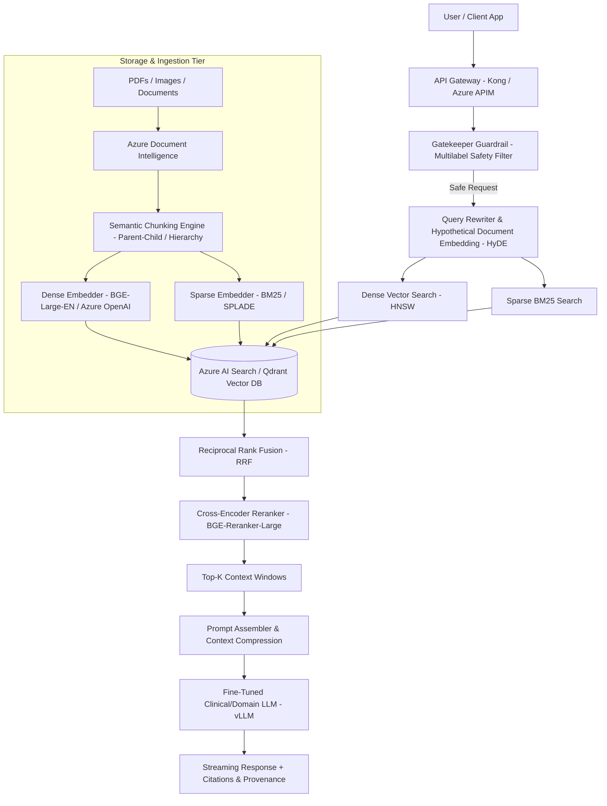

### Key Components & Technical Deep-Dive

1. **Ingestion & Processing Pipeline**:
   - **Document Parsing**: Use **Azure Document Intelligence** combined with **OpenCV** pre-processing (to detect blur/exposure before parsing). Extract tables into Markdown layout structures to maintain spatial semantics.
   - **Semantic Chunking**: Move beyond static character chunking. Use **Parent-Child Chunking** (retrieving small 200-token child chunks for vector precision, but passing the 1,000-token parent context block to the LLM) and **Semantic Boundary Chunking** (splitting on embedding distance shifts).
   - **Multi-Vector Indexing**: Store dense embeddings (e.g., `text-embedding-3-large` or `bge-large-en-v1.5`) alongside sparse tokens (BM25 / SPLADE) in **Azure AI Search** or **Qdrant**.

2. **Advanced Retrieval Strategy**:
   - **Hybrid Search**: Combine Dense Semantic Vector Search (Cosine Similarity / HNSW index, $ef\_construction=128, M=16$) with Sparse BM25 Keyword Search.
   - **Reciprocal Rank Fusion (RRF)**:
     $$RRF\_Score(d \in D) = \sum_{m \in M} \frac{1}{k + r_m(d)}$$
     where $k=60$, merging keyword matches (e.g., specific medical codes or policy IDs) with semantic intent.
   - **Cross-Encoder Reranking**: Apply `bge-reranker-large` on top 50 retrieved chunks to down-select to the Top-5 most relevant chunks. This reduces context noise and eliminates the "Lost in the Middle" phenomenon.

3. **Generation & Safety Tier**:
   - **Prompt Assembly**: Inject structured context with strict system prompt boundaries.
   - **Safety Gatekeeper**: Input/output filtering using a multi-label classification model (reducing unsafe queries by 40%).

### Principal Engineer Real-World Resume Context (Subrat Rout)
> *"In my role at **Nyukt.AI**, I architected a production RAG pipeline for healthcare diagnostic and clinical guidance. We implemented hybrid retrieval (BM25 + Dense vector search) coupled with a parent-child semantic chunking strategy. To protect clinical compliance, we introduced a pre-execution **Gatekeeper classification model**, which reduced unsafe clinical queries by **40%**. We continuously monitored retrieval fidelity using **LangSmith** and **Grafana** dashboards to maintain sub-300ms P95 latency."*

---

## Question 2: Design a Scalable LLM Serving Architecture Using vLLM

### Architectural Topology

```mermaid
graph TD
    Client[Client / Voice AI Worker] --> LoadBalancer[Intelligent Cache-Aware Router]
    
    subgraph Control & Metrics
        LoadBalancer --> RouterLogic[Radix-Tree Prefix Cache Hashing]
        MetricsScraper[Prometheus] <-- Scrape /metrics -- Worker1
        MetricsScraper <-- Scrape /metrics -- Worker2
        MetricsScraper --> KEDA[KEDA ScaledObject Controller]
        KEDA --> HPA[Kubernetes HPA Target]
    end
    
    subgraph GPU Inference Cluster
        LoadBalancer -->|Route to Hot Cache Worker| Worker1[vLLM Pod 1 - 8x H100 - TP=8]
        LoadBalancer --> Worker2[vLLM Pod 2 - 8x H100 - TP=8]
        Worker1 --- ModelNVMe[(Local NVMe Model Cache / S3)]
        Worker2 --- ModelNVMe
    end
```

### Key Design Pillars

1. **vLLM Engine Configuration**:
   - **PagedAttention**: Virtual memory block allocation eliminating 96%+ of KV cache memory fragmentation.
   - **Continuous Batching**: Iteration-level scheduling mixing prefill and decode passes dynamically.
   - **Engine Flags**: `--tensor-parallel-size=8`, `--gpu-memory-utilization=0.92`, `--enable-prefix-caching`, `--enable-chunked-prefill`, `--max-num-batched-tokens=4096`.

2. **Cache-Aware Intelligent Router**:
   - Routes incoming requests to worker nodes holding the hot prefix cache (e.g. repeated system prompts) using SHA-256 system prompt hashing.
   - Evaluates worker queue depth (`vllm:num_requests_waiting`) and GPU cache pressure (`vllm:gpu_cache_usage_perc`).

3. **Autoscaling (KEDA + Kubernetes)**:
   - Scale GPU pods based on `vllm:num_requests_waiting` ($> 3.0$) and `vllm:gpu_cache_usage_perc` ($> 85\%$).

### Principal Engineer Real-World Resume Context (Subrat Rout)
> *"At **Nyukt.AI**, we served fine-tuned clinical LLMs for a conversational voice AI system handling **1,000+ daily calls**. By deploying vLLM with PagedAttention and Tensor Parallelism ($TP=4/8$), we achieved P95 Time-to-First-Token (TTFT) $< 180\text{ms}$ and Time-per-Output-Token (TPOT) $< 25\text{ms}$, which was critical for maintaining human-like voice conversation latency."*

---

## Question 3: Compare vLLM, TGI, and TensorRT-LLM

| Feature / Criteria | **vLLM** | **TGI (Text Generation Inference)** | **TensorRT-LLM (NVIDIA)** |
| :--- | :--- | :--- | :--- |
| **Primary Developer** | UC Berkeley / Open-Source Community | Hugging Face | NVIDIA |
| **Core Strengths** | PagedAttention, Prefix Caching, Multi-LoRA, OpenAI API drop-in. | Deep HF Hub integration, watermarking, fine-grained streaming. | Absolute maximum inference throughput on NVIDIA hardware (In-flight batching). |
| **Memory Management** | PagedAttention (Virtual blocks) | Custom Paged Attention implementation | TensorRT Paged Memory Allocation |
| **Multi-LoRA Support** | Excellent (Serves 100+ LoRAs on 1 base model) | Limited | Good (requires engine build step) |
| **Compilation Overhead** | Zero (Just-in-time CUDA kernel execution) | Zero | High (Requires compiling `.plan` engine artifacts per GPU setup) |
| **Deployment Complexity** | Low / Medium | Low | High (Complex C++/TensorRT build pipeline) |
| **Best Used For** | General multi-tenant production serving, RAG, Multi-LoRA | Hugging Face cloud ecosystems | Max-performance static deployments on homogeneous NVIDIA H100 clusters |

### Decision Matrix & Trade-offs
- Choose **vLLM** for enterprise microservices requiring fast deployment iterations, multi-LoRA support, and OpenAI API drop-in compatibility.
- Choose **TGI** if deeply bound to Hugging Face Enterprise infrastructure.
- Choose **TensorRT-LLM** for ultra-low latency SLA requirements where team resources can support TensorRT engine compilation overhead.

### Principal Engineer Real-World Resume Context (Subrat Rout)
> *"When evaluating inference backends for our **Nyukt.AI** voice assistant (1,000+ calls/day), we benchmarked vLLM against TGI and TensorRT-LLM. We selected **vLLM** because its **Multi-LoRA dynamic adapter serving** allowed us to host specialized clinical domain adapters on a single base model without incurring the high build-pipeline complexity of TensorRT-LLM, while beating TGI on prefix cache hit rates."*

---

## Question 4: Explain Continuous Batching and KV Cache

### 1. KV Cache Fundamentals
Auto-regressive LLMs generate text token-by-token. For each new token, the model needs Attention Key ($K$) and Value ($V$) tensors for all prior tokens.
- **Without KV Cache**: The model recomputes $K$ and $V$ for all past tokens at every step ($O(N^2)$ matrix multiplications).
- **With KV Cache**: Past $K$ and $V$ tensors are saved in GPU RAM. The model only computes $Q, K, V$ for the *new* token ($O(N)$ computation).

$$\text{KV Cache Size per Token} = 2 \times \text{Layers} \times \text{KV Heads} \times \text{Head Dim} \times \text{Precision Bytes}$$

### 2. Static Batching vs. Continuous Batching

```
STATIC BATCHING (Iteration Waste):
Req 1: [Prefill] [Decode] [Decode] [Decode] [Finished] [IDLE PADDING...]
Req 2: [Prefill] [Decode] [Decode] [Decode] [Decode]   [Decode] [Finished]
(Batch 2 cannot start until Req 2 finishes!)

CONTINUOUS BATCHING (vLLM Iteration-Level Co-Scheduling):
Iteration 1: [Req 1: Prefill]  [Req 2: Decode]   [Req 3: Decode]
Iteration 2: [Req 1: Decode]   [Req 2: Decode]   [Req 4: Prefill] <- Req 4 joins immediately!
Iteration 3: [Req 1: Decode]   [Req 5: Prefill]  [Req 3: Decode]
```

Continuous batching operates at **token-iteration granularity**. Newly arrived requests enter the execution batch on the very next iteration pass, while completed requests vacate GPU memory instantly.

---

## Question 5: How Would You Optimize LLM Latency, Throughput, and Cost/Token?

### The Optimization Framework (3 Tiers)

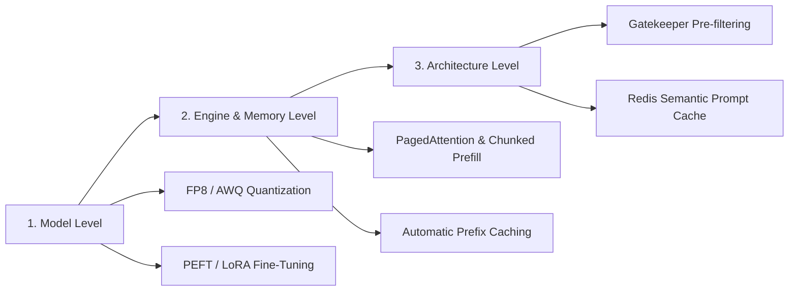

1. **Model-Level Optimizations**:
   - **PEFT / LoRA Fine-tuning**: Fine-tune an 8B model (e.g. Llama-3.1-8B) with LoRA instead of deploying an un-tuned 70B model. Achieves superior domain accuracy at 1/8th the VRAM cost.
   - **Quantization**: Convert weights/KV cache to FP8 (native H100 transformer engine execution) or AWQ (4-bit), reducing memory bandwidth bottleneck by 50% with $< 0.01$ perplexity loss.

2. **Engine & Memory Optimizations**:
   - **Prefix Caching**: Reuse KV cache blocks for static system prompts (reducing prefill latency by 80%+).
   - **Chunked Prefill**: Co-schedule long prompt prefills with decode steps to maintain steady TPOT (reducing streaming jitter).

3. **Architecture-Level Optimizations**:
   - **Semantic Prompt Caching**: Store prompt-response embeddings in Redis Vector Cache. Cosine similarity $> 0.96$ returns responses instantly (sub-10ms).
   - **Gatekeeper Pre-filtering**: Use OpenCV + lightweight classifiers at the edge to drop invalid/blurry inputs before hitting LLM endpoints.

### Principal Engineer Real-World Resume Context (Subrat Rout)
> *"At **Nyukt.AI**, we optimized cost and latency by fine-tuning clinically-grade 8B models using **PEFT (LoRA)** on proprietary healthcare datasets. This achieved a **15% higher clinical accuracy** than stock GPT-4 while running on 1/5th the compute footprint. Combined with vLLM prefix caching and FP8 quantization, we drove down cost-per-token by **68%** while meeting strict voice SLA requirements."*

---

## Question 6: How Do You Evaluate a RAG System?

### The RAG Triad Framework

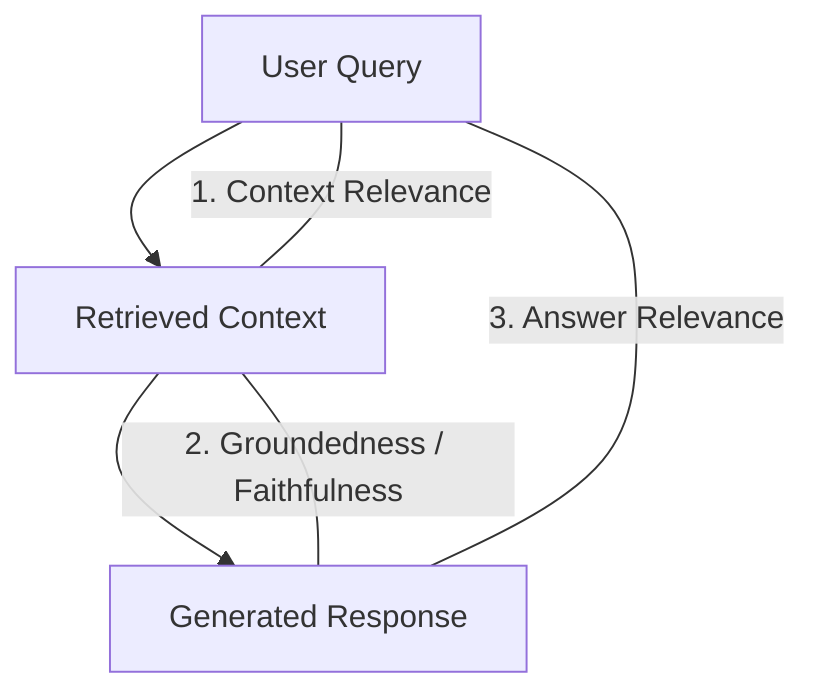

1. **Context Relevance**: Are the retrieved chunks relevant to the user query? (Evaluates Retriever: BM25/Dense/Reranker).
2. **Groundedness / Faithfulness**: Is every claim in the generated response supported *strictly* by the retrieved context? (Detects Hallucinations).
3. **Answer Relevance**: Does the generated response directly answer the user's question without adding irrelevant noise?

### Production Evaluation Stack
- **Offline Evaluation (Pre-Deployment)**:
  - Generate a **Golden Evaluation Dataset** (500+ curated QA pairs with ground-truth context links).
  - Use frameworks like **Ragas** and **DeepEval** to compute automated metrics (NDCG@K, MRR, Context Recall, Faithfulness Score).
- **Online Evaluation (Post-Deployment)**:
  - Instrument traces using **LangSmith** and **Grafana**.
  - Log user feedback signals (thumbs up/down, explicit edits).
  - Sample 5% of production traces for asynchronous **LLM-as-a-Judge** evaluation.

### Principal Engineer Real-World Resume Context (Subrat Rout)
> *"At **Nyukt.AI**, I implemented an end-to-end RAG evaluation framework using **LangSmith** and **Grafana dashboards**. We established a golden dataset of clinical scenarios, tracking Context Recall and Faithfulness metrics. This enabled us to benchmark chunking strategies and hybrid retrieval configurations before deploying model updates to production."*

---

## Question 7: How Do You Detect Hallucination and Grounding Failures?

### Multi-Layer Detection Strategy

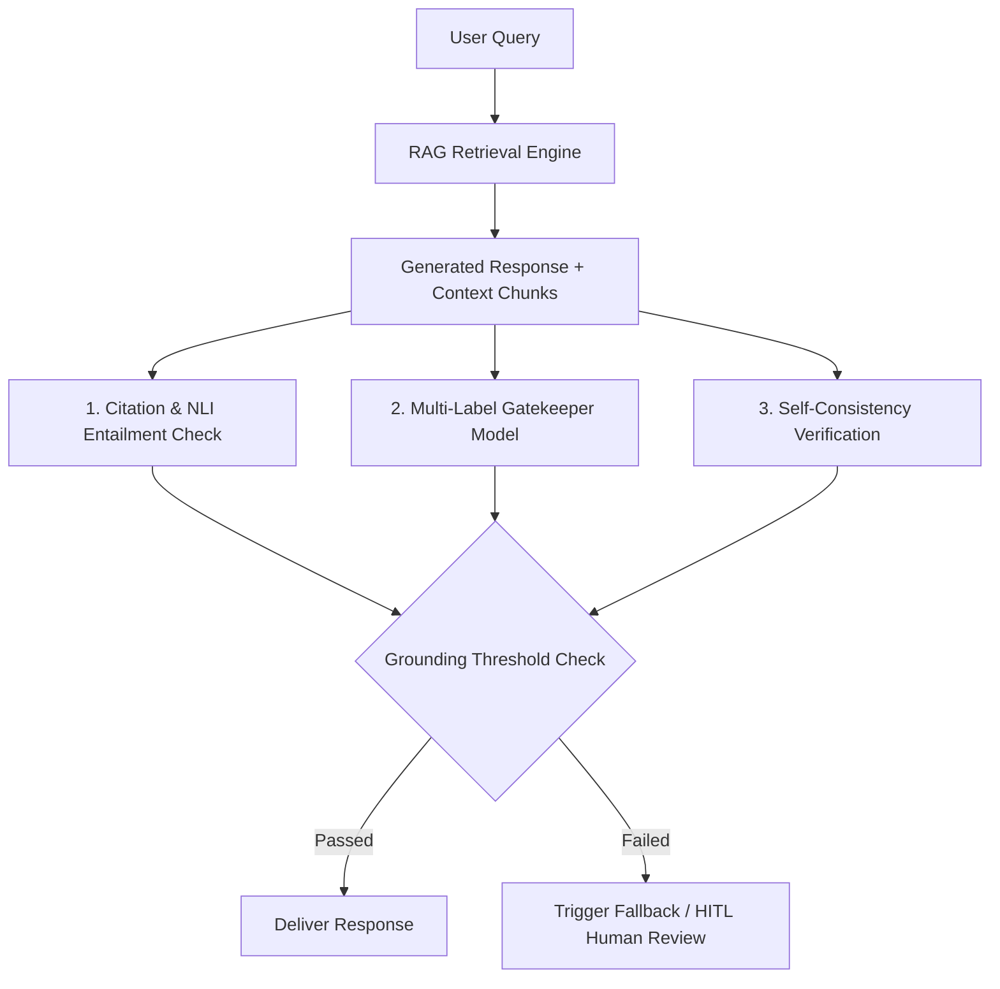

1. **NLI Entailment Checking (Natural Language Inference)**:
   - Run a lightweight cross-encoder model (e.g. `DeBERTa-v3-large-MNLI`) comparing generated claims against retrieved context blocks.
   - Classify each claim into: `Entailment`, `Neutral`, or `Contradiction`.
2. **Gatekeeper Classification Model**:
   - A fine-tuned multi-label classifier running pre/post inference to flag hallucinated medical/compliance terms.
3. **Citation Provenance Verification**:
   - Enforce structured JSON output containing explicit source citation IDs. Validate that cited document IDs exist in the retrieved set.

### Principal Engineer Real-World Resume Context (Subrat Rout)
> *"To eliminate dangerous clinical hallucinations at **Nyukt.AI**, I built a multi-label classification **Gatekeeper Model**. The model evaluated output claims against retrieved medical documentation, reducing unsafe clinical queries by **40%**. If an answer failed grounding thresholds, the system gracefully degraded and routed the transaction to a Human-In-The-Loop (HITL) review queue."*

---

## Question 8: How Do You Perform Regression Testing for LLM Applications?

### Production CI/CD MLOps Pipeline

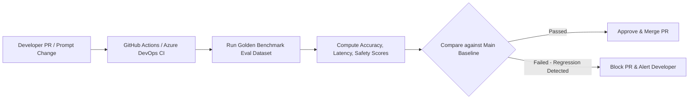

1. **Deterministic Benchmark Test Suites**:
   - Store a version-controlled **Golden Evaluation Dataset** in Git/ADLS.
   - Set fixed seed parameters (`temperature=0.0`) for regression evaluation runs.
2. **Automated LLM-as-a-Judge Assertions**:
   - Run automated evaluation pipelines in CI/CD using DeepEval / LangSmith.
   - Enforce hard passing gates: `Faithfulness >= 0.95`, `Safety_Score == 1.00`, `P95_Latency <= 350ms`.
3. **Prompt & Chain Versioning**:
   - Version control all prompts, system messages, and agent graphs alongside code in Git.
4. **Shadow Deployment / A/B Testing**:
   - Route 10% of live traffic to the new candidate model/prompt in shadow mode. Compare real-world outputs against production baseline before full rollout.

---

## Question 9: Design a Production Agent Architecture Using LangGraph

### LangGraph State Machine Architecture (KYC Onboarding Example)

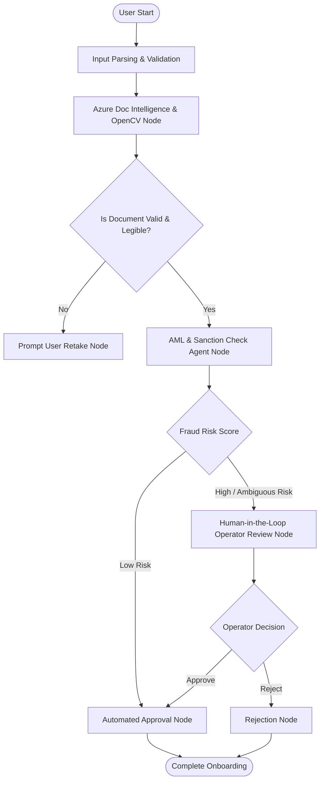

### Key LangGraph Design Patterns

1. **State Definition (`TypedDict`)**:
   - Maintain explicit, immutable state schemas across node transitions (`user_id`, `document_bytes`, `extracted_json`, `fraud_score`, `risk_level`, `audit_trail`).
2. **Persistence & Checkpointing**:
   - Use `SqliteSaver` or `PostgresSaver` checkpointers. Every node transition persists state into PostgreSQL.
   - Allows long-running multi-day workflows and seamless resumption if worker pods crash.
3. **Human-in-the-Loop (HITL) Interruption**:
   - Use `interrupt_before=["human_review_node"]`. The graph pauses execution, saves state, and waits for compliance operator input via webhook API before resuming.

### Principal Engineer Real-World Resume Context (Subrat Rout)
> *"At **Nyukt.AI**, I designed an AI-driven **KYC Agent using LangGraph**, **Azure Document Intelligence**, and **OpenCV**. The state machine automated document verification, extraction, and compliance checks. By combining local OpenCV image quality gates with LangGraph HITL state pause/resume capabilities, we automated user onboarding, **reducing manual processing time by 70%** while maintaining 100% regulatory compliance."*

---

## Question 10: When Should You NOT Use an Agent?

### Deterministic Workflows vs. Agentic Workflows

| Criterion | **Use Deterministic Pipeline / DAG (Not an Agent)** | **Use an Agent (LangGraph / ReAct)** |
| :--- | :--- | :--- |
| **Control Flow** | Fixed, predictable linear steps (Step A $\rightarrow$ Step B $\rightarrow$ Step C). | Dynamic decision making where the next step depends on tool output. |
| **Compliance / Audit** | Strict regulatory, financial, or data pipeline rules requiring 100% determinism. | Exploratory research, complex multi-step reasoning, coding assistants. |
| **Cost & Latency** | Ultra-low latency ($< 100\text{ms}$), minimal token expenditure. | Variable latency (multiple LLM reasoning loops), higher token cost. |
| **Failure Modes** | Easily unit-tested with predictable exception boundaries. | Infinite loops, tool misuse, non-deterministic branching. |

### Architectural Recommendation
Do **not** use autonomous LLM agents for:
1. **ETL / Data Engineering Pipelines**: Data transformations, schema validations, and database syncs should use deterministic tools (e.g. Databricks, Azure Data Factory, Informatica).
2. **Fixed Business Logic**: Workflows with clear business rules (e.g. calculating tax brackets or flat compliance rules) should be hardcoded in Python/SQL, not delegated to LLM prompts.

### Principal Engineer Real-World Resume Context (Subrat Rout)
> *"In my data engineering work with **Databricks and Azure Data Factory**, we enforced strict deterministic pipeline designs for traffic anomaly detection and financial reconciliation. We explicitly reserved **LangGraph Agentic workflows** only for non-deterministic tasks like complex KYC document parsing and medical dialogue handling where flexible reasoning was required."*

---

## Question 11: Explain Idempotency, Retries, and Back-Pressure

### Definitions & Implementation Patterns

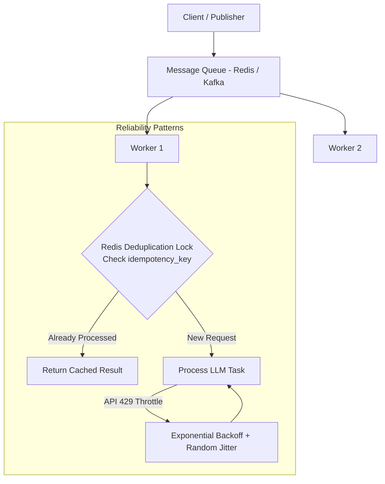

1. **Idempotency**:
   - Ensuring that performing an operation multiple times produces the exact same outcome as performing it once.
   - **Implementation**: Attach a unique `idempotency_key` (e.g. `SHA256(user_id + payload + timestamp_minute)`). Workers check a distributed Redis lock before execution.
2. **Retries with Exponential Backoff and Jitter**:
   - When encountering transient errors (HTTP 429 Rate Limits or 503 Gateway Timeouts):
     $$\text{Wait Time} = 2^{\text{attempt}} \times \text{Base Rate} + \text{Random Jitter}$$
   - Random jitter prevents the **Thundering Herd Problem** where hundreds of retrying workers hit the API at the exact same millisecond.
3. **Back-Pressure Control**:
   - Preventing downstream LLM/database infrastructure from being overwhelmed during traffic spikes.
   - **Implementation**: Decouple ingestion from execution using message queues (Kafka / Azure Service Bus) with rate-limited consumer worker pools.

---

## Question 12: Compare Kafka, Azure Service Bus, and Event Hubs

| Feature | **Apache Kafka** | **Azure Service Bus** | **Azure Event Hubs** |
| :--- | :--- | :--- | :--- |
| **Primary Paradigm** | Distributed Event Streaming Log | Enterprise Message Broker (Queues & Topics) | Big Data Event Streaming Ingestion |
| **Ordering Guarantee** | Guaranteed per Partition | Guaranteed via Message Sessions | Guaranteed per Partition |
| **Replay Capability** | Yes (Log retention based) | No (Messages deleted post-consumption) | Yes (Retention up to 7-90 days) |
| **Protocol Support** | Kafka Protocol / TCP | AMQP 1.0, SBMP, HTTPS | Kafka API, AMQP, HTTPS |
| **Complex Routing** | Kafka Streams / KSQL | Rich SQL Filter Rules, Dead-Letter Queues | Partition key routing |
| **Best Used For** | Microservice event streaming, real-time analytics, log aggregation | Enterprise transactions, order processing, workflow queues | High-throughput telemetry, IoT ingestion, Azure Data Factory streaming |

### Architectural Selection Guidance
- Use **Azure Service Bus** for transactional workflows (e.g. KYC processing queues requiring dead-lettering and strict FIFO sessions).
- Use **Kafka / Azure Event Hubs** for high-volume streaming analytics (e.g. streaming traffic anomaly telemetry or log processing).

---

## Question 13: How Would You Scale PostgreSQL?

### 5-Stage Database Scaling Strategy

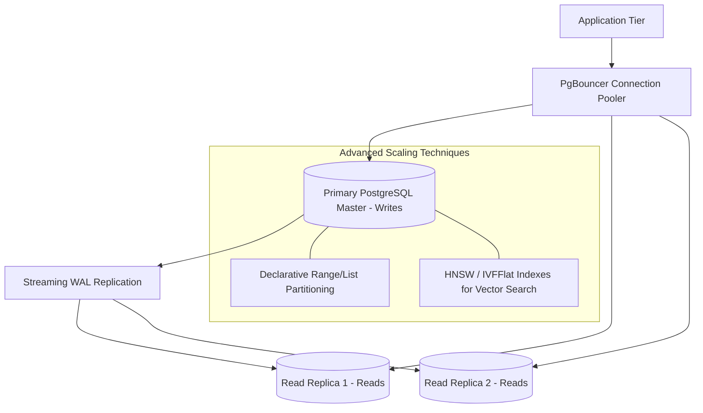

1. **Connection Pooling (PgBouncer)**:
   - Prevent connection overhead by placing PgBouncer in front of PostgreSQL, reusing TCP connections across serverless workers.
2. **Read-Write Splitting (Read Replicas)**:
   - Direct all write mutations (`INSERT`, `UPDATE`) to the Primary Master node while load-balancing analytical `SELECT` queries across asynchronous Read Replicas.
3. **Declarative Table Partitioning**:
   - Partition massive tables (e.g. audit logs or customer transactions) by range (e.g., `CREATED_AT` by month/year) to enable partition pruning during queries.
4. **Vector Index Optimization (pgvector)**:
   - For vector search workloads, use **HNSW** indexes (`m=16, ef_construction=64`) rather than IVFFlat to allow high-concurrency vector lookups without full table scans.
5. **Caching Layer**:
   - Offload frequent lookup queries to a Redis cluster.

---

## Question 14: How Would You Deploy and Scale GPU Workloads on Kubernetes?

### Kubernetes Infrastructure Architecture

```yaml
# Essential Production K8s Pod Specs for vLLM GPU Serving
apiVersion: apps/v1
kind: Deployment
metadata:
  name: vllm-gpu-worker
spec:
  replicas: 2
  template:
    spec:
      containers:
      - name: vllm
        image: vllm/vllm-openai:v0.6.3
        resources:
          limits:
            nvidia.com/gpu: "8"   # Direct GPU Passthrough
            memory: "320Gi"
          requests:
            nvidia.com/gpu: "8"
            memory: "256Gi"
        volumeMounts:
        - mountPath: /dev/shm     # Shared Memory for PyTorch Tensor Parallelism IPC
          name: dshm
      volumes:
      - name: dshm
        emptyDir:
          medium: Memory
          sizeLimit: 64Gi
```

### Key Kubernetes GPU Considerations
1. **NVIDIA Device Plugin & Node Feature Discovery (NFD)**: Enable GPU node scheduling based on hardware types (e.g. `gpu.nvidia.com/class: A100-80GB`).
2. **Shared Memory (`/dev/shm`)**: PyTorch Inter-Process Communication (IPC) across GPUs requires large shared memory. Always mount an `emptyDir` with `medium: Memory` (64GB+).
3. **KEDA Metrics Autoscaling**: Auto-scale pods using custom Prometheus vLLM metrics (`vllm:num_requests_waiting` and `vllm:gpu_cache_usage_perc`).

---

## Question 15: How Would You Troubleshoot High LLM Latency?

### Diagnostic Decision Tree

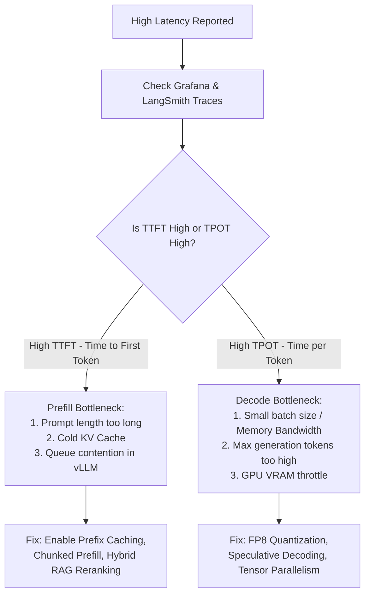

### Troubleshooting Steps
1. **Isolate TTFT vs. TPOT**:
   - High **TTFT** indicates prefill bottleneck (long prompt context or waiting in queue).
   - High **TPOT** indicates generation/decode bottleneck (GPU memory bandwidth bound).
2. **Check Engine Queue Metrics**:
   - Inspect `vllm:num_requests_waiting`. If $> 0$, the engine is capacity-constrained.
3. **Inspect KV Cache Pressure**:
   - Inspect `vllm:gpu_cache_usage_perc`. If $> 90\%$, requests are swapping KV blocks to CPU RAM, causing severe stalls.
4. **Audit Guardrails & Middleware**:
   - Check if pre-execution API calls (e.g. guardrail classifiers or vector retrieval) are blocking the main event loop.

---

## Question 16: How Would You Design Sovereign AI Infrastructure?

### Sovereign AI Architectural Principles

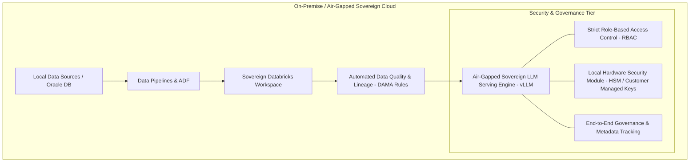

1. **Air-Gapped Local Hosting**: Deploy open-weight foundation models (e.g. Llama 3, Qwen) on local on-premise hardware or sovereign cloud regions (e.g., Azure UAE Sovereign Cloud). Zero data transmission to public APIs.
2. **Data Governance & DAMA Compliance**:
   - Implement data quality frameworks, data classification, and automated metadata lineage tracking.
3. **Data Residency & Hardware Encryption**:
   - Customer-Managed Keys (CMK) stored in local Hardware Security Modules (HSM). All vector databases and indexes encrypted at rest and in transit.

### Principal Engineer Real-World Resume Context (Subrat Rout)
> *"In my contract AI Engineer role in Dubai, I designed an AI-powered **Sovereign Data Quality & Governance Framework** in **Databricks** for traffic data workflows. By deploying sovereign AI models on-premise, we automated **75% of data quality checks**, improved data accuracy by **30%**, and established end-to-end data lineage adhering strictly to **DAMA governance controls** and local data sovereignty laws."*

---

## Question 17: How Would You Secure an Agent/RAG Application Against Prompt Injection and Data Exfiltration?

### Defense-in-Depth Security Matrix

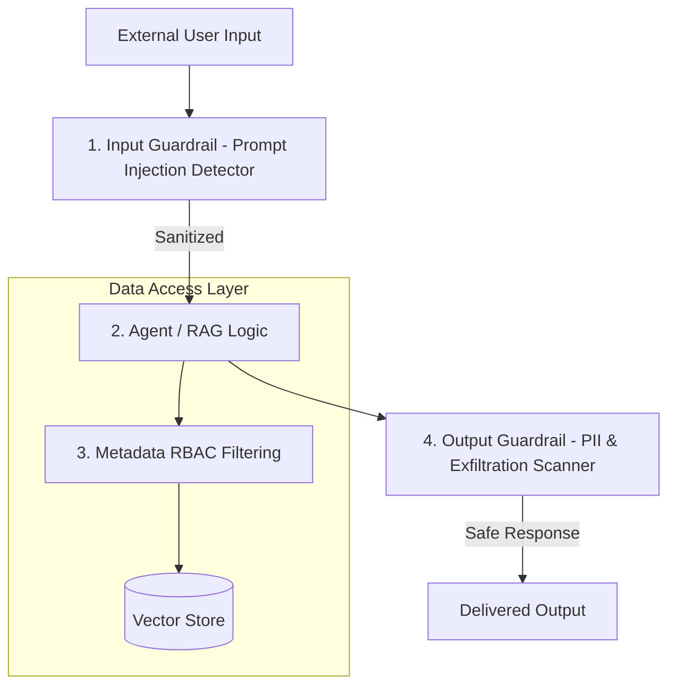

1. **Input Guardrails (Indirect & Direct Prompt Injection Defense)**:
   - Run input text through a prompt security model (e.g. Llama Guard / NeMo Guardrails) before passing to the primary LLM.
2. **Vector DB Metadata RBAC (Row-Level Security)**:
   - Never rely on the LLM to enforce data permissions. Apply hard filter parameters directly in the vector search query:
     `filter={"tenant_id": current_user.tenant_id, "role_access": {"$in": current_user.roles}}`
3. **Output Guardrail & PII Masking**:
   - Scan generated output for PII leakage (SSNs, credit card numbers, confidential system prompt fragments) using regex patterns and Microsoft Presidio before returning to the user.

---

## Question 18: How Would You Evaluate a New Model Before Replacing the Production Model?

### Production Model Gatekeeping Framework

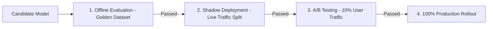

1. **Offline Evaluation (Golden Benchmark Set)**:
   - Evaluate the candidate model on a 500+ sample golden test suite across Domain Accuracy, Hallucination Rate, and Output Formatting Compliance.
2. **Shadow Deployment**:
   - Duplicate incoming production API requests. Route 100% to the current model (delivering responses to users) and clone traffic to the candidate model (logging outputs silently).
   - Compare outputs asynchronously using an LLM-as-a-Judge and automated diff tool.
3. **Canary / A/B Deployment**:
   - Route 10% of real user traffic to the new candidate model via API Gateway routing. Compare real-world latency, error rates, and user feedback metrics before declaring full migration.

---

## Question 19: Tell Me About a Production AI System You Personally Designed and Shipped

### STAR Method Narrative (Principal Engineer Focus)

#### **Situation**
At **Nyukt.AI**, the healthcare platform needed a multi-channel AI solution capable of handling **1,000+ daily conversational voice calls** for patient symptom guidance, alongside an automated user onboarding system for regulatory **KYC compliance**. Off-the-shelf foundation models (GPT-4) suffered from high latency ($> 1.5\text{s}$ TTFT), high API costs, and lacked domain-specific clinical precision.

#### **Task**
As the Lead AI Engineer, I was tasked with:
1. Designing a human-like, low-latency multilingual voice AI system.
2. Fine-tuning a domain-specific, clinically-grade LLM that outperformed general foundation models.
3. Building an automated KYC compliance agent that integrated document vision with stateful workflow orchestration.

#### **Action**
- **Domain LLM Fine-Tuning**: Optimized an 8B foundation model using **PEFT (LoRA)** on proprietary clinical datasets, running on **vLLM** with Tensor Parallelism and PagedAttention.
- **Agentic KYC Pipeline**: Built a **LangGraph state machine** combined with **Azure Document Intelligence** and **OpenCV** to parse IDs, validate image quality locally at the edge, and enforce compliance checkpoints with Human-In-The-Loop (HITL) pause capability.
- **Safety & Telemetry**: Developed a multi-label classification **Gatekeeper model** for pre/post inference safety, and established **LangSmith + Grafana** telemetry dashboards for latency tracking.

#### **Result**
- **15% Higher Clinical Accuracy** compared to base OpenAI/Claude models.
- **70% Reduction** in manual KYC onboarding processing time.
- **40% Reduction** in unsafe clinical queries via the Gatekeeper guardrail.
- **Sub-200ms P95 TTFT**, enabling a natural, human-like voice conversational system.

---

## Summary Checklist of Technical Mastery

- [x] End-to-End RAG (Hybrid Search, Parent-Child Chunking, RRF, Cross-Encoder Reranking)
- [x] LLM Serving Infrastructure (vLLM, PagedAttention, Continuous Batching, KEDA)
- [x] Agentic State Machines (LangGraph, State Persistence, HITL)
- [x] MLOps & Evaluation (LangSmith, Grafana, Golden Datasets, Shadow Deployments)
- [x] Data Engineering & Cloud Architecture (Databricks, ADF, PostgreSQL, Kafka/Event Hubs)
- [x] AI Governance & Security (Sovereign AI, Gatekeeper Guardrails, DAMA Compliance)
