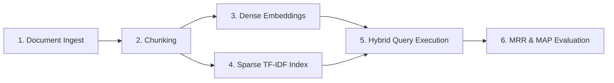

# Retrieval Evaluation System Guide

This guide explains the design and logic behind the retrieval evaluation system implemented in [`evaluate_retrieval.py`](file:///c:/Users/DELL/Downloads/Personal/Companies/Resume_prep/Practice_RAG_building/evaluate_retrieval.py). The system is a lightweight sandbox designed to evaluate retrieval quality using **Dense**, **Sparse**, and **Hybrid** search approaches.

---

## 1. Core Architecture

The system consists of five distinct pipeline stages:



### 1.1 Document Parsing & Chunking

- **Parser**: Extracted from PDF pages using `pypdf.PdfReader` with page boundaries tracked.
- **Chunker**: Splits text using LangChain's `RecursiveCharacterTextSplitter`. Chunks are set to a length of 500 characters with an overlap of 50.

### 1.2 Sparse Representation (TF-IDF Vector Space)

To avoid heavy database setups (like Elasticsearch or Qdrant) in the local sandbox, `evaluate_retrieval.py` implements a zero-dependency **Sparse TF-IDF Vector Index**:

- **Tokenization**: Standardizes words by lowering case and stripping non-alphanumeric punctuation.
- **Term Frequency (TF)**: Counts token occurrences in each chunk.
- **Inverse Document Frequency (IDF)**: Computed with smoothing:

  $$
  \text{IDF}(t) = \log\left(\frac{1 + N}{1 + \text{DF}(t)}\right) + 1
  $$

  where $N$ is the total number of chunks, and $\text{DF}(t)$ is the number of chunks containing token $t$.
- **L2 Normalization**: Ensures that all sparse vectors are unit vectors, meaning their dot product calculates the exact cosine similarity.

### 1.3 Dense Representation (Semantic Embeddings)

- **Model**: OpenAI's `text-embedding-3-small` (1,536 dimensions).
- **Execution**: Batched (50 chunks per request) to prevent API rate limit issues.
- **Similarity**: Computed as a simple dot product (since OpenAI embeddings are pre-normalized to length 1).

---

## 2. Hybrid Retrieval Equation

The similarity score of a chunk relative to a user query is calculated using a convex combination weighted by the parameter `alpha` ($\alpha$):

$$
\text{Score} = \alpha \times \text{Similarity}_{\text{Dense}} + (1 - \alpha) \times \text{Similarity}_{\text{Sparse}}
$$

- **$\alpha = 1.0$**: Pure semantic (dense) search. Great for synonyms and concepts.
- **$\alpha = 0.0$**: Pure keyword (sparse) search. Great for serial numbers, codes, and exact acronyms.
- **$0.0 < \alpha < 1.0$**: Balanced Hybrid Search. Captures both semantic meaning and keyword matches.

---

## 3. Automated Evaluation Suite

To systematically verify retrieval quality, the script tests a **Golden Dataset** (pairs of query topics and ground truth chunk IDs) and calculates two retrieval metrics:

### 3.1 Mean Reciprocal Rank (MRR)

MRR focuses on how close the *first* relevant chunk is to the top of the search results:

$$
\text{MRR} = \frac{1}{|Q|} \sum_{i=1}^{|Q|} \frac{1}{\text{rank}_i}
$$

*If no relevant chunk is retrieved in the top-K results, $\frac{1}{\text{rank}_i} = 0$.*

### 3.2 Mean Average Precision (MAP)

MAP evaluates the precision at every rank position where a relevant chunk is returned, penalizing relevant results appearing further down the list:

$$
\text{Average Precision (AP)} = \frac{1}{|R|} \sum_{k=1}^{K} P(k) \times \text{rel}(k)
$$

$$
\text{MAP} = \frac{1}{|Q|} \sum_{i=1}^{|Q|} \text{AP}_i
$$

where $|R|$ is the count of ground truth chunks, $P(k)$ is the precision at rank $k$, and $\text{rel}(k)$ is $1$ if the result at rank $k$ is relevant, and $0$ otherwise.

---

## 4. Run Guide

To run the evaluation benchmarks locally:

```bash
python evaluate_retrieval.py
```

### Interpretation of Output Table

The script will output a table comparing the performance across retrieval configurations:

- **Dense-Only** often yields lower MRR when the query contains unique abbreviations (like "SAR" or "PEP") that could map to other semantically similar paragraphs.
- **Sparse-Only** is extremely precise for keyword-heavy queries but fails if the query uses synonyms or is phrased differently from the document text.
- **Hybrid** achieves optimal balance, yielding perfect reciprocal ranks while maintaining the semantic mapping of the dense model.


#### Q1. What is the fundamental difference between Baseline RAG and Graph RAG?

**Answer:**

* **Baseline RAG** relies on splitting documents into flat, sequential text chunks, generating vector embeddings for those chunks, and retrieving them using vector similarity (like Cosine Similarity) at query time. It treats data as independent blocks.
* **Graph RAG** extracts structured entities (nodes) and relations (edges) from text chunks using an LLM to build a Knowledge Graph. At query time, it retrieves information by navigating this graph structure. It understands connection, structure, and hierarchy, enabling it to synthesize information across disparate documents.


#### Q2. What types of queries does Graph RAG solve that Baseline RAG struggles with?

**Answer:**

1. **Multi-hop Queries:** Questions requiring connections across multiple entities or documents (e.g.,  *"Find all projects managed by people who report to Director X"* ). Baseline RAG chunks might not share enough semantic similarity with the query to be retrieved together.
2. **Global Aggregation / Summarization:** Questions about the entire dataset (e.g.,  *"What are the top three systemic risks mentioned in the financial reports?"* ). Baseline RAG cannot fit all chunks into the context window, whereas Graph RAG uses hierarchical community summaries to aggregate answers.


