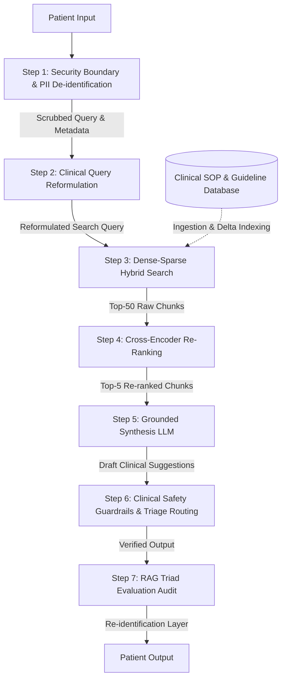
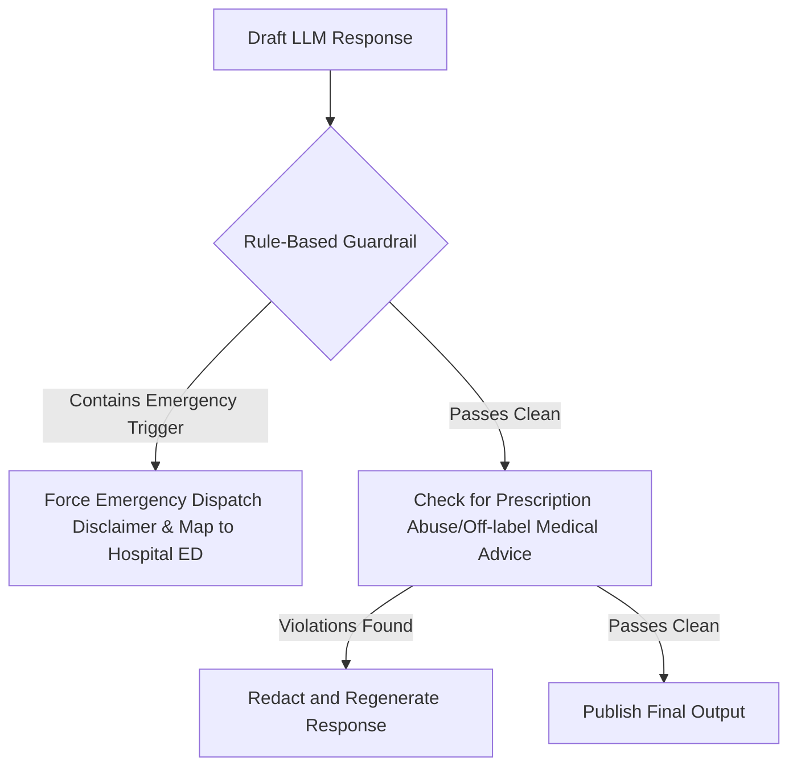
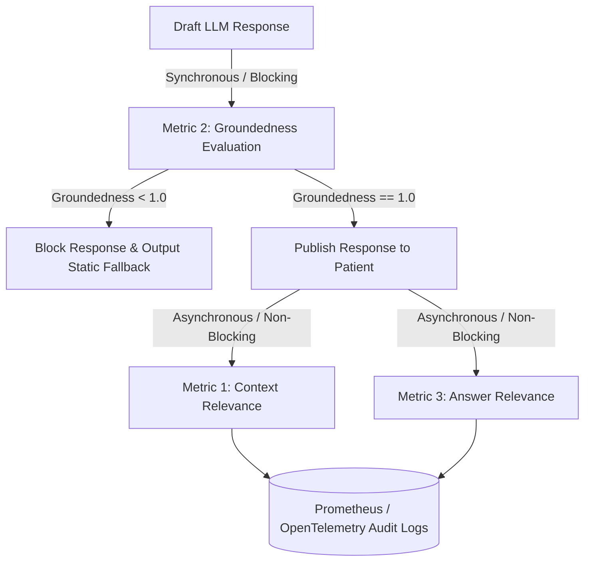

### Clinical RAG Architecture: Self-Symptom Assessment Pipeline

This document outlines the end-to-end system design for a medical-grade, HIPAA-compliant, AI-powered symptom assessment tool. It uses a Retrieval-Augmented Generation (RAG) architecture to ingest patient symptoms, retrieve validated clinical guidelines and hospital Standard Operating Procedures (SOPs), and generate safe triage suggestions via a medical-grade LLM.

---

## 1. End-to-End System Architecture

The diagram below illustrates how a raw user query is processed, secured, enriched, retrieved, re-ranked, and synthesized into a safe clinical triage recommendation.



---

## 2. Step-by-Step Processing for John Doe's Clinical Query

### Patient Profile Context

* **Raw Query**: `"My name is John Doe and my email is john@example.com. My stomach pain is getting worse and I keep throwing up. Nothing stays inside."`
* **Age**: `47` | **Gender**: `Male` | **Duration**: `8 hours`
* **Existing Medical History**: `Alcohol Use Disorder (AUD)`
* **Identifiers**: `session_id`, `user_id`

---

### Step 1: Security Boundary & PII De-identification

Under **HIPAA (Health Insurance Portability and Accountability Act)** and **GDPR**, patient queries containing Protected Health Information (PHI) and Personally Identifiable Information (PII) cannot be passed to public model APIs or stored plaintext in vector databases.

1. **PII Masking**: The incoming payload is intercepted by a local, highly-optimized de-identification worker (e.g., using Microsoft Presidio or custom NER models trained on clinical text).
   * **Raw Query**: `"My name is John Doe and my email is john@example.com. My stomach pain is getting worse..."`
   * **Scrubbed Query**: `"My stomach pain is getting worse and I keep throwing up. Nothing stays inside."`
2. **Deterministic Token Mapping**: The real identity mapping (`John Doe` / `john@example.com` $\rightarrow$ `user_id_9921`) is encrypted and written to a secure, ephemeral SQL database (e.g., PostgreSQL with Column-level Encryption using AES-256-GCM). Only the de-identified version is routed to the RAG components.
3. **Audit Logging**: Write access logs to a tamper-proof log stream (e.g., AWS CloudTrail or a dedicated blockchain ledger) verifying that no raw PHI passed downstream.

---

### Step 2: Clinical Query Reformulation & Semantic Expansion

Patients describe symptoms using layperson terminology. If searched directly, vector databases and BM25 fail to retrieve specific clinical guidelines. We use a lightweight, specialized LLM (or a clinical translation map) to translate and expand the query.

1. **Input Variables**:
   * Scrubbed Query: `"stomach pain is getting worse, keep throwing up, nothing stays inside"`
   * Structured Metadata: `Age: 47, Male, Duration: 8 hours, History: Alcohol Use Disorder`
2. **Translation & Expansion**:
   * *Lay Term*: "Stomach pain getting worse" $\rightarrow$ *Clinical Term*: "Acute worsening abdominal pain, epigastric pain"
   * *Lay Term*: "Keep throwing up / nothing stays inside" $\rightarrow$ *Clinical Term*: "Intractable emesis, inability to tolerate oral fluids (PO intake), high dehydration risk"
   * *Clinical Associations (Differential Triage)*: The combination of chronic Alcohol Use Disorder (AUD) + acute worsening epigastric pain + severe emesis strongly points to **Acute Pancreatitis**, **Alcoholic Ketoacidosis (AKA)**, **Acute Gastritis/Esophageal Varices Bleeding**, or **Mallory-Weiss tears**.
3. **Reformulated Search Query**:
   > `"Acute worsening epigastric abdominal pain, intractable emesis, inability to tolerate PO fluids, dehydration risk, complicating Alcohol Use Disorder, Acute Pancreatitis triage guidelines."`
   >

---

### Step 3: Ingestion & Vector Index Structure (Delta Indexing & Scale)

To serve the query, the system retrieves guidelines from the **Clinical SOP Index** (e.g., UpToDate articles, Schmitt-Thompson Triage Protocols, and internal Hospital Emergency SOPs). This index handles updates and ingestion at scale as outlined in the interview guide:

1. **1M+ Document Scale Ingestion**:
   * The hospital database parses SOP updates using Celery workers with stream parsing.
   * Embeddings are pre-generated using a biomedical-specific embedding model (e.g., `BioLinkBERT-base` or `Clinical-BERT`) to capture medical semantics accurately.
2. **Delta Indexing**:
   * When clinical SOPs are modified, they are updated via content hashing (SHA-256) and deterministic IDs: `f"{sop_id}_chunk_{index}"`.
   * Overwrites are automatically handled in Pinecone to prevent outdated protocol retrieval.

---

### Step 4: Hybrid Search & Retrieval (Dense + Sparse)

Dense semantic search alone struggles with specific codes (ICD-10, SNOMED-CT) and clinical terms. We execute a **Dense-Sparse Hybrid Search** to ensure exact clinical criteria matches alongside conceptual overlap.

1. **Dense Query Execution**:
   * Generate vector embeddings from the reformulated query: $\vec{q}_{\text{dense}} \in \mathbb{R}^{768}$ (using a Clinical BERT model).
   * Search Pinecone using HNSW (Approximate Nearest Neighbors) to calculate cosine similarity.
2. **Sparse Query Execution**:
   * Generate sparse weights (using SPLADE or BM25) highlighting exact terms: `["Pancreatitis", "Emesis", "Alcohol Use Disorder", "ICD-10: K85.9 (Acute Pancreatitis)"]`.
3. **Combining Strategies (System Design Decision)**:
   In production, we have two primary options for combining these dense and sparse results. We compare them below:

#### Option A: Convex Scoring Combination (Score-Based)

* **Formula**:
  $$
  \text{Score}(d) = \alpha \cdot \text{Score}_{\text{Dense}}(d) + (1 - \alpha) \cdot \text{Score}_{\text{Sparse}}(d)
  $$
* **Mechanics**: We set $\alpha = 0.7$ to prioritize semantic clinical context while retaining a $30\%$ weight on exact lexical matches.
* **Prerequisite**: Requires score normalization (e.g., min-max scaling or sigmoid transformation) because dense scores (cosine similarity $0.0 \dots 1.0$) and sparse scores (BM25 $0.0 \dots 30.0+$) are on different scales.

#### Option B: Reciprocal Rank Fusion - RRF (Rank-Based)

* **Formula**:
  $$
  \text{RRF\_Score}(d \in D) = \sum_{m \in M} \frac{1}{k + r_m(d)}
  $$

  * $M$: The set of retrievers (Dense and Sparse).
  * $r_m(d)$: The rank of document $d$ in the result list of retriever $m$.
  * $k$: A constant smoothing parameter (typically set to $60$ to prevent high-ranking documents from overly dominating the score).
* **Mechanics**: Retrieve the top-100 results from the dense search and the top-100 from the sparse search. Compute their combined reciprocal rank scores, sort them, and take the top-50 merged candidates.

| Factor                          | Option A: Convex Scoring                                                                                                               | Option B: Reciprocal Rank Fusion (RRF)                                                                                   |
| :------------------------------ | :------------------------------------------------------------------------------------------------------------------------------------- | :----------------------------------------------------------------------------------------------------------------------- |
| **Normalization**         | **Required & Hard**: Normalizing disparate scales is unstable across different queries.                                          | **Not Required**: Bypasses scores entirely and operates solely on rankings.                                        |
| **Safety tuning**         | **Easier**: Can directly prioritize semantic understanding by tuning the $\alpha$ weight.                                      | **Harder**: Relative ranks are discrete; adjusting weights requires weighted RRF variants.                         |
| **Distance Preservation** | **Yes**: Retains the actual similarity distance (e.g., a document matching at $0.92$ is treated as much closer than $0.71$). | **No**: Ranks are ordinal. The distance between Rank 1 and Rank 2 is treated identically regardless of score drop. |
| **Production Support**    | Supported natively by custom vector db configurations (e.g., Pinecone hybrid index).                                                   | Supported natively by modern enterprise search engines (e.g., Elasticsearch, Vespa).                                     |

**Production Recommendation for Clinical RAG**: We recommend **Option B (RRF)** for its production robustness and implementation simplicity (no normalization issues), but with a **Cross-Encoder Re-ranker downstream (Step 5)** to recover the lost semantic distance information before the context is fed to the LLM.

---

### Step 5: Cross-Encoder Re-Ranking

Bi-Encoders (dense retrievers) score query and document independently, losing fine-grained contextual relationships. We feed the top-50 retrieved chunks into a **Cross-Encoder Model** (e.g., `bge-reranker-large` fine-tuned on clinical Q&A).

1. **How it works**: The Cross-Encoder performs self-attention over the *concatenation* of the reformulated query and the retrieved SOP chunk: `[CLS] Query [SEP] Chunk [SEP]`.
2. **Priority Boosting**: The re-ranker is tuned to promote "Red Flag" safety protocols (e.g., guidelines featuring words like "shock", "intractable vomiting", "pancreatic necrosis", or "emergency triage") to the top of the context window.
3. **Output**: The top-5 most relevant, high-safety chunks are selected for prompt injection.

---

### Step 6: Grounded Synthesis LLM

The top-5 re-ranked SOP chunks, along with the structured patient metadata, are formatted into a prompt for a HIPAA-compliant medical-grade LLM instance (e.g., Med-PaLM 2 or Azure GPT-4o-Medical).

#### Prompt Construction:

```text
SYSTEM PROMPT:
You are a medical-grade triage assistant. Your role is to suggest triage levels based ONLY on the provided Hospital Standard Operating Procedures (SOPs).
- Do not diagnose the patient. Instead, highlight potential risks.
- If the symptoms match "Red Flags" (e.g., severe abdominal pain, inability to keep fluids down for >6 hours, severe vomiting, or history of alcohol abuse presenting with abdominal pain), route the patient to IMMEDIATE EMERGENCY EVALUATION.
- Cite the specific SOP guidelines used (e.g., [SOP: Abdominal Pain Protocol, Section 2]).
- Keep your tone objective, reassuring, and highly safety-oriented.

CONTEXT:
[SOP Chunk 1: Acute Abdominal Pain Triage]
"Red Flags requiring Emergency Department referral include: Severe abdominal pain worsening over time, intractable vomiting, and inability to retain fluids for 6+ hours..."
[SOP Chunk 2: Alcohol-Induced Pancreatic Complications]
"Patients presenting with chronic Alcohol Use Disorder and acute epigastric pain with persistent nausea/vomiting are at high risk for Acute Pancreatitis (ICD-10: K85). Triage priority: Immediate emergency evaluation."

PATIENT INFO:
- Age: 47 | Gender: Male | Duration: 8 hours
- History: Alcohol Use Disorder (AUD)
- Current Symptoms: Worsening abdominal/stomach pain, persistent vomiting, unable to tolerate fluids.

USER QUERY:
"{Scrubbed Query}"

CLINICAL RECOMMENDATION:
```

---

### Step 7: Clinical Safety Guardrails & Triage Routing

Before generating output, the system runs the response through a dual-path safety guardrail.



1. **Rule-Based Emergency Triage Trigger**:
   * Given: Worsening stomach pain + vomiting for 8 hours + AUD.
   * The rule-engine matches the rule: `(Abdominal_Pain_Worsening AND Vomiting_Duration > 6_Hours) OR (Abdominal_Pain AND History == Alcohol_Use_Disorder) -> Urgent_Triage_Level = EMERGENCY`.
   * This forces the system to prepend a prominent, un-bypassable alert: **"IMMEDIATE EMERGENCY DEPARTMENT EVALUATION REQUIRED. Call 911 or go to the nearest ER."**
2. **Clinical Output Guardrails**:
   * Verify that the LLM has not suggested specific prescription drugs (e.g., antiemetics like Ondansetron) which could delay necessary emergency care for pancreatitis.
   * Redact any speculative, absolute diagnoses (e.g., "You have pancreatitis"). Frame it as "Your symptoms represent a clinical picture that requires urgent evaluation."

---

## 3. Real-Time Evaluation & Quality Metrics (The RAG Triad)

To prevent clinical hallucinations and ensure retrieval quality, we evaluate every transaction in production using **The RAG Triad** (Query, Context, Response). In a production architecture, these metrics are routed differently to balance safety and latency:



---

### Step-by-Step Implementation of the RAG Triad

#### Metric 1: Context Relevance (Query $\rightarrow$ Context)

* **Goal**: Measure if the retrieved SOP chunks are relevant and sufficient to answer the user query.
* **Execution**: **Asynchronous**. Run in a background thread or celery task after the response is rendered to audit search quality.
* **LLM-as-a-Judge Prompt**:

```text
SYSTEM:
You are an expert clinical search auditor. Rate the relevance of the retrieved clinical context chunks to the user's query on a scale of 0.0 to 1.0.
- A score of 1.0 means the context contains all necessary medical guidelines to triage the query.
- A score of 0.5 means the context is partially relevant but misses key aspects (e.g., misses the patient's existing disease context).
- A score of 0.0 means the context is completely irrelevant.

Output JSON format only:
{
  "reasoning": "Explain step-by-step why the score was given.",
  "score": 0.85
}

USER:
Query: "Acute worsening epigastric abdominal pain, intractable emesis, inability to tolerate PO fluids, dehydration risk, complicating Alcohol Use Disorder..."
Context: [Concatenated SOP Chunks]
```

---

#### Metric 2: Groundedness / Faithfulness (Context $\rightarrow$ Response)

* **Goal**: Verify that the generated suggestions are derived *only* from the retrieved context. (Zero tolerance for hallucinating medical advice or drug dosages).
* **Execution**: **Synchronous (Blocking)**. Must run before rendering the output to the patient.
* **Implementation Logic**:
  1. **Claim Extraction**: Split the LLM draft response into discrete, independent sentences/claims (using NLTK or regex sentence tokenizer).
  2. **NLI/LLM Verification**: Evaluate each claim against the retrieved context to verify if it is `Supported` (Entailed), `Contradicted`, or `Neutral` (not mentioned in context).

```python
# Production pseudocode for Groundedness evaluation
import json
from openai import OpenAI

def evaluate_groundedness(context: str, response: str) -> float:
    # 1. Split response into sentences/claims
    claims = [s.strip() for s in response.split('.') if len(s.strip()) > 10]
    supported_claims = 0
  
    client = OpenAI()
  
    # 2. Verify each claim
    for claim in claims:
        prompt = f"""
        Context: {context}
        Claim: {claim}
      
        Determine if the Claim is directly supported by the Context.
        Output JSON:
        {{
          "verdict": "SUPPORTED" | "CONTRADICTED" | "NEUTRAL"
        }}
        """
        eval_resp = client.chat.completions.create(
            model="gpt-4o-mini",
            response_format={"type": "json_object"},
            messages=[{"role": "user", "content": prompt}],
            temperature=0.0
        )
        verdict = json.loads(eval_resp.choices[0].message.content)["verdict"]
      
        if verdict == "SUPPORTED":
            supported_claims += 1
        elif verdict == "CONTRADICTED":
            # Immediate fail on direct contradiction of medical SOPs
            return 0.0

    # 3. Compute score (ratio of supported claims)
    return supported_claims / len(claims)
```

* **Production Action**: If the returned score is $< 1.00$ (meaning even a single sentence is an ungrounded hallucination), the response is discarded, and the system falls back to a pre-approved static emergency card.

---

#### Metric 3: Answer Relevance (Query $\rightarrow$ Response)

* **Goal**: Verify if the response actually addresses the patient’s primary concerns (vomiting, pain, AUD) rather than giving generic medical advice.
* **Execution**: **Asynchronous**. Runs in the background for system quality tracking.
* **Implementation (Query Reconstruction Technique)**:
  1. Feed the LLM response to an evaluator model.
  2. Ask the evaluator: *"Based ONLY on the response provided, generate the hypothetical clinical question the user must have asked."*
  3. Calculate the semantic similarity (e.g. Cosine Similarity) between the *Reconstructed Query* and the *Original Query*.
  4. If similarity $< 0.85$, flag the session for manual clinician audit.

---

---

## 4. Key Performance Indicators (KPIs) & Production SLAs

| Metric                                 | Target SLA / Threshold                  | Mitigation if Failed                                                                                            |
| :------------------------------------- | :-------------------------------------- | :-------------------------------------------------------------------------------------------------------------- |
| **End-to-End Latency**           | $< 1800 \text{ ms}$ (95th percentile) | Stream output processing; cache query embeddings.                                                               |
| **Retrieval Recall@5**           | $> 98\%$ on Gold Dataset              | Re-tune dense-sparse hybrid weight$\alpha$; adjust chunk size.                                                |
| **Mean Reciprocal Rank (MRR)**   | $> 0.85$                              | Indicates safety protocols are retrieved at rank 1 or 2. If lower, tune the Cross-Encoder re-ranker.            |
| **Mean Average Precision (MAP)** | $> 0.80$                              | Ensures all relevant context blocks are prioritized high in the prompt context.                                 |
| **PII Leakage Rate**             | **0.00% (Strict Block)**          | Stop response transmission if any string matching names or email structures is detected in downstream payloads. |
| **Groundedness Score**           | $1.00$ (Pass/Fail)                    | Response is intercepted and blocked if a hallucination is detected.                                             |

---

## 5. De-Scrubbing & Final Response Rendering

Once the output is verified as safe, grounded, and compliant with all clinical guidelines, it is passed through the re-identification layer.

1. **Re-identification**: The token `user_id_9921` is mapped back in local server memory to render:
   > *"Hello John, based on the symptoms you've described..."*
   >
2. **Clinical Action Plan Rendering**:
   * The UI displays the emergency warning at the top in red.
   * It provides a button to find the nearest Emergency Department based on the patient's current location (or integrated GPS metadata).
   * It provides a button to instantly share the structured summary (Age 47, Male, AUD, 8 hrs vomiting) with the triage nurse upon arrival at the hospital, facilitating faster intake and clinical handoff.

---

## 6. Production Readiness Audit: What is Missing?

While this system design provides a highly robust blueprint, it is **not yet safe for live clinical deployment**. In an interview, discussing these limitations shows deep production maturity. The following critical gaps must be resolved:

### 1. Regulatory Compliance (FDA Software as a Medical Device - SaMD)

* **Status**: **BLOCKER**
* **Issue**: Because the system interprets symptoms, computes triage priorities, and guides patient decision-making, it falls under the FDA’s definition of **Software as a Medical Device (SaMD)**.
* **Action Required**: You must determine the risk categorization (typically Class II or Class III depending on whether the output is intended to guide immediate clinical action for life-threatening conditions). The system must undergo rigorous clinical trials and secure FDA 510(k) or De Novo clearance before deployment to patients in the United States.

### 2. Clinical Ground Truth Validation (Schmitt-Thompson Protocols)

* **Status**: **CRITICAL**
* **Issue**: Hospital SOPs are often unstructured. The system needs to be mapped to a standardized clinical framework (such as the industry-standard **Schmitt-Thompson Triage Protocols** used by 90%+ of telehealth services).
* **Action Required**: The Golden Evaluation Dataset must include thousands of clinical test cases curated by board-certified physicians, covering a wide range of red-flag symptoms. Any model update must maintain $100\%$ accuracy on high-acuity (emergency) cases.

### 3. Medical Terminology Mapping (UMLS, SNOMED-CT, RxNorm)

* **Status**: **HIGH PRIORITY**
* **Issue**: Relying purely on LLM query translation introduces semantic drift. If the LLM incorrectly maps a colloquial symptom to a clinical term (e.g., mapping "chest tightness" to "stable angina" instead of "myocardial infarction"), retrieval will fail.
* **Action Required**: Integrate a deterministic clinical terminology mapper (e.g., using UMLS, SNOMED-CT, or RxNorm databases) alongside the LLM translation layer to anchor medical synonyms.

### 4. Deterministic Fail-Safe (Zero-Downtime Rule Fallback)

* **Status**: **HIGH PRIORITY**
* **Issue**: If the LLM, embedding API, or Pinecone index experiences high latency (exceeding the $1800\text{ ms}$ SLA) or outage, the application cannot hang or crash. In clinical settings, a hang could lead to patient harm.
* **Action Required**: Implement a **Hard-Coded Rule Engine** running client-side or on a separate edge-worker. If the RAG pipeline times out or fails:
  ```text
  If (Age >= 45 AND Severe_Abdominal_Pain AND Vomiting AND History == Alcohol_Use) -> IMMEDIATELY bypass LLM and render Emergency Red-Flag screen.
  ```

### 5. Multi-Turn Conversational State Tracking (Active Triage)

* **Status**: **HIGH PRIORITY**
* **Issue**: Patients rarely provide all diagnostic details in a single query. Triage protocols require active questioning (e.g., "Do you see blood in your vomit?", "Does the pain radiate to your back?").
* **Action Required**: Implement a conversational agent framework (like LangGraph or temporal state machines) to manage state. The system must prompt the user with 2-3 specific follow-up questions from the retrieved triage guidelines before determining the final triage category.
