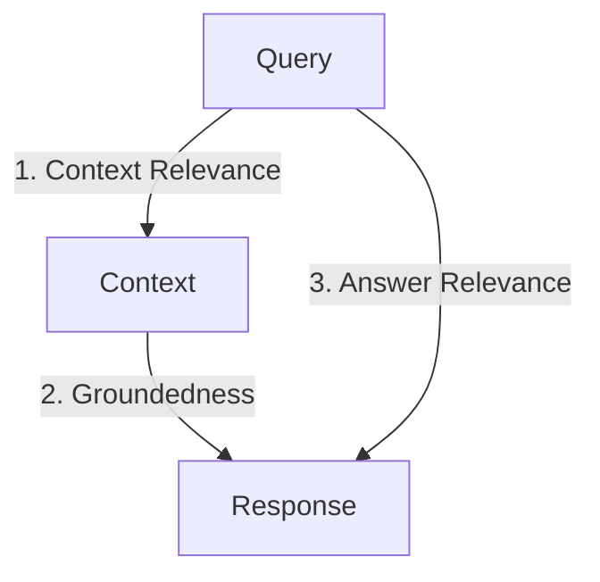

# Production RAG System Design: Interview Q&A Guide

This guide is designed for preparing for system design and architecture interviews focused on large-scale Retrieval-Augmented Generation (RAG) pipelines. It assumes a production requirement of **1 million+ documents** (translating to ~30M+ chunks) and covers ingestion, updates, retrieval, evaluation, and hallucination management.

---

## Section 1: Ingestion Architecture & Scaling (1M+ Files)

### Q1.1: How would you design an ingestion pipeline to process 1 million PDF documents without crashing or running out of memory?

**Answer:**
To scale ingestion to 1M+ files, you must use a decoupled, event-driven, distributed architecture rather than a monolithic script.

1. **Queue-Based Decoupling**: Store incoming document metadata in an event queue (e.g., Apache Kafka or AWS SQS). A message represents a document event (`{ "document_id": "123", "action": "INGEST" }`).
2. **Distributed Workers**: Deploy stateless worker pods (e.g., Celery in Kubernetes) that pull tasks from the queue. Workers scale horizontally based on queue depth.
3. **Stream Parsing**: Avoid loading whole large documents into memory. Use s  treaming parsers (like PyMuPDF or Unstructured) to parse page-by-page.
4. **Embedding Batching & Rate Limiting**: Group chunks into batches (e.g., 100-250 chunks) before sending them to the embedding model API. Implement exponential backoff with jitter (e.g., using libraries like `tenacity`) to handle API rate limits (HTTP 429).
5. **Backpressure Control**: Limit the number of concurrent tasks per worker node to prevent local memory overload and Pinecone write throttling.

### Q1.2: Embedding APIs (e.g., OpenAI) can be expensive and slow for 30 million chunks. How do you optimize cost and throughput?

**Answer:**

1. **Self-Hosted Embedding Models**: For massive scale, self-host a model (e.g., `bge-large-en-v1.5` or `all-MiniLM-L6-v2`) on GPU instances (using Triton Inference Server or vLLM). This turns variable API costs into fixed infrastructure costs.
2. **Bulk Ingestion & Vector Compaction**: During initial ingestion, run heavy batch inference. Store results in local parquet files before writing to the vector database.
3. **Change Detection (Deduplication)**: Only embed changed content by utilizing content hashing (see Section 2).

---

## Section 2: Document Updates & Delta Indexing (Upserts/Deletions)

### Q2.1: In a live system, files are added, modified, and deleted continuously. How do you update the vector database without rebuilding the entire index?

**Answer:**
We implement **Delta Indexing** utilizing a relational database (e.g., PostgreSQL) alongside the vector database:

1. **Content Hashing**: Compute a SHA-256 hash of the raw document. Before parsing, compare the hash to the one stored in the metadata database. If the hash matches, skip parsing and embedding entirely.
2. **Deterministic ID Generation**: Instead of random UUIDs, generate vector IDs using a deterministic format: `f"{document_id}_chunk_{chunk_index}"`.
3. **Pinecone Upsert Overwrite**: When a document is updated, upserting vectors with the same deterministic IDs automatically overwrites the old vectors in Pinecone.
4. **Orphan Vector Deletion**: If the updated document has fewer chunks than the previous version ($N_{\text{new}} < N_{\text{old}}$), we calculate the range of orphan indices $[N_{\text{new}} \dots N_{\text{old}} - 1]$ and issue a bulk `delete(ids=[...])` call to Pinecone.
5. **Document Deletion**: When a document is deleted, perform a prefix delete in Pinecone (or filter by metadata `document_id` and delete) and remove the entries from PostgreSQL.

### Q2.2: How do you handle write failures or database crashes during an upsert operation to prevent state drift between the SQL DB and the Vector DB?

**Answer:**
We must treat the multi-database write as a **Saga Pattern** or an **Outbox Pattern**:

1. **Outbox Pattern**: Write the update task to a transaction log in PostgreSQL. A separate CDC (Change Data Capture) tool (like Debezium) or a reliable background worker pulls tasks from the log, upserts vectors to Pinecone, and updates the task status to `COMPLETED` only when Pinecone confirms the write.
2. **Reconciliation Loop**: Implement an overnight cron job that compares the document hash list in the SQL DB with the indexed vector prefixes in Pinecone. If inconsistencies are found (e.g., missing chunks or orphaned vectors due to a crash), the job triggers a repair event for the affected document IDs.

---

## Section 3: Retrieval Scale & Hybrid Search

### Q3.1: Why is Dense semantic search insufficient for enterprise RAG systems, and how does Hybrid Search solve this?

**Answer:**

* **Dense Search Limitations**: Dense embeddings map text into a continuous vector space where similarity is based on overall semantic concepts. It struggles with:
  - Exact identifiers (e.g., SKU "A-4839-X", product serial numbers, client names).
  - Out-of-vocabulary acronyms (e.g., proprietary corporate jargon).
  - Keyword matching in short queries.
* **Hybrid Search Solution**: Combines Lexical (Sparse) search and Semantic (Dense) search.
  - **Lexical/Sparse Vector**: Uses term statistics (BM25 or neural SPLADE) where each dimension corresponds to a dictionary token, and the value is its importance score.
  - **Convex Combination**: Scores are combined using:
    $$
    \text{Score} = \alpha \cdot \text{Score}_{\text{Dense}} + (1 - \alpha) \cdot \text{Score}_{\text{Sparse}}
    $$

    This guarantees that the system retrieves documents containing exact key phrases and codes while preserving semantic context mapping.

### Q3.2: How does a vector database retrieve queries in milliseconds over 30 million vectors?

**Answer:**
It uses **Approximate Nearest Neighbor (ANN)** search instead of calculating the exact similarity to all vectors (which is $O(N)$ and too slow):

1. **HNSW (Hierarchical Navigable Small World)**: Creates a multi-layer graph where the top layers have sparse connections for fast routing, and the bottom layers have dense connections for precise local search. Searching operates like navigating a highway network down to local roads.
2. **IVF (Inverted File Index)**: Partitions the vector space into clusters using k-means. The query is compared against cluster centroids, and search is restricted to the closest clusters.
3. **Product Quantization (PQ)**: Compresses high-dimensional vectors to tiny byte codes. This reduces RAM footprint, allowing millions of vectors to fit into fast-access memory and speeding up distance calculations.

---

## Section 4: Evaluation & Benchmarking

### Q4.1: Explain the difference between MRR (Mean Reciprocal Rank) and MAP (Mean Average Precision). When would you choose one over the other?

**Answer:**

* **Mean Reciprocal Rank (MRR)**:
  - **Definition**: Evaluates only the position of the *first* relevant document.
  - **Formula**: $\text{MRR} = \frac{1}{|Q|} \sum_{i=1}^{|Q|} \frac{1}{\text{rank}_i}$
  - **Use Case**: Best for question-answering systems, search engines, or RAG systems that only feed the top-1 chunk into the prompt. It evaluates: "Did we get a correct answer immediately?"
* **Mean Average Precision (MAP)**:
  - **Definition**: Evaluates the quality across *all* retrieved positions, rewarding systems that place all relevant documents at the top of the retrieval list.
  - **Formula**: Computes the mean of the Average Precision (AP) for all queries.
  - **Use Case**: Best for multi-document synthesis, recommender systems, or legal discovery where the LLM needs to synthesize information spread across multiple chunks in the top-K context.

### Q4.2: How do you build a Golden Evaluation Dataset for a corpus of 1 million documents?

**Answer:**
Building a test dataset manually is slow and expensive. In production, we use a hybrid approach:

1. **Synthetic Generation (LLM-as-a-Judge)**:
   - Sample 1,000 representative document chunks.
   - Prompt an LLM (e.g., GPT-4) to generate 2-3 hypothetical user questions that can be answered *only* using that chunk.
   - Record the mapping of `generated_question -> [source_chunk_id]` as the ground truth.
2. **Log Mining**: Extract actual user queries from search logs. Use senior annotators to manually label relevant chunks for the top 200 most frequent queries.
3. **Evaluation Run**: Run the retriever on the dataset. Calculate MRR, MAP, and Recall@K. Tune chunk size, overlap, and hybrid alpha weights based on these metrics.

---

## Section 5: Hallucination Detection & Mitigation

### Q5.1: What is the "RAG Triad" framework for evaluation, and how does it detect hallucinations?

**Answer:**
The RAG Triad (conceptualized by TruLens) evaluates the three connections in a RAG loop:



1. **Context Relevance**: Evaluates if the retrieved chunks are relevant to the query. If low, the LLM will hallucinate because it has bad raw material.
2. **Groundedness (Faithfulness)**: Evaluates if the LLM's response is derived *only* from the retrieved context. An LLM-as-a-Judge parses the response into statements and verifies if each statement is backed by the context. If statements are unsupported, a **hallucination** is detected.
3. **Answer Relevance**: Evaluates if the final response directly addresses the user's query.

### Q5.2: What active mitigation techniques do you implement in production to reduce hallucinations?

**Answer:**

1. **Strict Prompt Grounding**: Use system prompts that enforce boundaries: *"Answer the question using only the context provided. If the answer cannot be found in the context, state 'I cannot find the answer.' Do not make up information."*
2. **Citation Enforcement**: Require the LLM to output footnotes citing specific document names or page numbers from the context blocks (e.g., `[Document A, Page 4]`).
3. **Self-Reflection (Self-RAG)**: Prompt the LLM to verify its own answer against the context before streaming it to the user.
4. **Output Guardrails**: Use tools like NeMo Guardrails or LlamaGuard to check if the generated output references facts outside the input context.
5. **Context Window Optimization**: Avoid stuffing the prompt with irrelevant chunks. Keep context highly curated using re-ranking models (like Cohere ReRank) to reduce noise.

### Q5.3: What is NVIDIA NeMo Guardrails, and how does it secure a production RAG application?

**Answer:**
**NVIDIA NeMo Guardrails** is an open-source framework designed to add programmable safety, security, and semantic boundaries (guardrails) to LLM-powered applications. It acts as an execution middleware layer between the user, the database/RAG retrieval system, and the LLM.

#### 1. Core Concepts & Configuration

* **Colang**: A lightweight, declarative domain-specific programming language developed by NVIDIA to define conversational flows, detect intents, and configure rules.
* **YAML Config**: Used to define models, system parameters, and active rails (e.g., active input/output blocks).

#### 2. The Four Pillars of Guardrails

* **Input Guardrails**: Screen user queries *before* they are processed.
  * *Utility*: Blocks prompt injections, jailbreak attempts, off-topic requests, and toxic/inappropriate language.
* **Retrieval Guardrails (RAG-specific)**: Validate the context chunks returned by the retriever *before* sending them to the LLM.
  * *Utility*: Ensures retrieved chunks do not contain sensitive data the user isn't authorized to see, and filters out low-relevance chunks to prevent context noise.
* **Output Guardrails**: Screen the draft response generated by the LLM *before* it is displayed to the user.
  * *Utility*: Checks for groundedness (hallucinations), screens for toxic or sensitive information leaks, and verifies tone/compliance.
* **Execution Guardrails**: Control and validate tool calls, API requests, or database actions initiated by the LLM.
  * *Utility*: Prevents the model from executing unauthorized code or executing API payloads with malicious parameters.

#### 3. How NeMo Guardrails Operates Under the Hood

1. **Intent Mapping**: NeMo Guardrails maps user prompts to canonical intents (defined in Colang) using a vector embedding database.
2. **Flow Execution**: If the intent triggers a predefined flow (e.g., *"user asks off-topic compliance question"*), NeMo instantly routes the conversation along a hardcoded path (e.g., *"reply: 'I can only assist with KYC queries'"*) bypassing the LLM.
3. **Real-Time LLM Validation**: For open-ended flows (like answering clinical questions), NeMo uses sub-LLM calls (e.g. self-checking prompts) or NLI classifier models to evaluate specific guardrail criteria (e.g. *"Is the output backed by the context? Yes/No"*). If it returns No, NeMo replaces the response with a fallback sentence.

---

## Section 6: Agent-to-Agent (A2A) Protocols & Fail-Safe Architectures

### Q6.1: What is an Agent-to-Agent (A2A) Protocol, and how does it prevent coordination failure in multi-agent production RAG?

**Answer:**
An **Agent-to-Agent (A2A) Protocol** is a structured communication and state management contract that governs how independent LLM agents interact, share state, and delegate sub-tasks without causing cascading formatting failures or context-window pollution.

In a clinical symptom-assessment setup, we orchestrate agents (e.g., *Intake Agent*, *Retriever Agent*, *Triage Agent*, and *Safety Auditor Agent*) using these core A2A specifications:

1. **Unified Envelope Schema (A2A Message)**: Every communication between agents must use a standardized JSON envelope that supports distributed tracing:
   ```json
   {
     "trace_id": "tx_9981-ab7",
     "sender_agent": "Retriever_Agent_v1",
     "target_agent": "Triage_Agent_v2",
     "timestamp": "2026-05-21T13:30:00Z",
     "payload": { "retrieved_sops": [...] },
     "confidence_score": 0.94
   }
   ```
2. **Strict Schema Constraints (Type Safety)**: Agent outputs are validated at runtime using schemas (such as Pydantic). If Agent A returns an output that does not match the strict schema expected by Agent B, the message is intercepted by the orchestrator before causing a downstream crash.
3. **Shared Context State Monad (Graph Memory)**: Instead of passing whole dialogue dumps back and forth (which wastes tokens and risks context dilution), agents read and write to a scoped, central State Graph (e.g., LangGraph state). Each agent has restricted read/write permissions over specific sub-keys (e.g., only the Safety Agent can modify the `safety_alert_triggered` key).

### Q6.2: How do you handle hallucinations, API timeouts, and failed agent responses in a production-grade agentic pipeline?

**Answer:**
To build a resilient production pipeline, we implement a multi-layered defense strategy:

1. **Structured Parser Self-Correction (Retry Loops)**:
   If an agent's output fails schema parsing (e.g., invalid JSON structure) or fails the Groundedness metric (has a hallucination), the system triggers an inline, automatic correction loop (capped at **2 attempts**):
   * Feed the invalid output and the parsing/groundedness error trace back to the LLM.
   * *System Prompt*: *"Your previous output was invalid due to: [Error]. Re-generate the output strictly following the guidelines and schema."*
2. **Circuit Breakers & Graceful Degradation**:
   If an agent fails both retry attempts, or if downstream LLM/vector API calls time out, a **Circuit Breaker** pattern (e.g., using patterns similar to Netflix Hystrix) trips. The request immediately bypasses the agentic pipeline and redirects to a deterministic **Fallback Engine**.
   * For example, in our symptom assessment tool, if the Triage Agent crashes, the system defaults to a static emergency warning card based purely on the structured intake metadata (e.g., `Age > 45` + `Vomiting` + `AUD` = `Call 911`).
3. **Consensus-Based Verification (Multi-Agent Debate)**:
   For high-risk decisions, we execute parallel evaluations. A *Primary Triage Agent* proposes a triage level (e.g., `Emergency` vs `Urgent Care`), and a separate *Validator Agent* evaluates the reasoning. If they disagree, the system routes the session to the highest severity category automatically (err on the side of safety) and alerts a human reviewer.
4. **Rate Limiting & Queue Backpressure**:
   When API limits (HTTP 429) are reached, workers pause ingestion/queries and implement **Exponential Backoff with Jitter** using libraries like `tenacity` to prevent cascade failure under load.

---

## Section 7: GCP Deployment, Observability Stack, and Model Drift Monitoring

### Q7.1: If we deploy our LLM/RAG application in Google Cloud Platform (GCP), how do we monitor "Model Drift" and evaluate performance metrics? Will we use Grafana, LangSmith, or GCP-native tools?

**Answer:**
In a production-grade enterprise deployment on GCP, you do not choose *one* tool; instead, you build a **three-tiered observability stack** that separates **business/agent tracing** (LangSmith/LangFuse), **system/infrastructure metrics** (Grafana/Cloud Monitoring), and **long-term analytical audit trails** (GCP Cloud Logging + BigQuery).

Here is how the architecture is mapped:

| Observability Layer                                             | Target Metrics                                                                                                               | Primary Tooling                                                                   | GCP Integration                                                                                                        |
| :-------------------------------------------------------------- | :--------------------------------------------------------------------------------------------------------------------------- | :-------------------------------------------------------------------------------- | :--------------------------------------------------------------------------------------------------------------------- |
| **Application & Agent Tracing (The LLM Layer)**           | Step-by-step agent traces, prompt versions, LLM input/output pairs, RAG Triad scores, hallucinations, retrieval token costs. | **LangSmith** (or self-hosted **LangFuse / Arize Phoenix**)           | Integrated via environment SDK variables in GKE/Cloud Run.                                                             |
| **System Operations (The Infrastructure Layer)**          | CPU/GPU utilization, API latency (p95/p99), QPS/throughput, HTTP error rates (4xx/5xx), network I/O, service health.         | **Prometheus + Grafana** or **Google Cloud Monitoring (Stackdriver)** | GCP native GKE metrics dashboard or Prometheus metrics exporter routed to a Grafana Cloud dashboard.                   |
| **Data Warehousing & Custom Analytics (The Audit Layer)** | Raw payload logging for compliance, ad-hoc sql evaluation, semantic drift calculation over time.                             | **GCP Cloud Logging & BigQuery**                                            | GKE/Cloud Run logs are routed via a GCP log router sink directly to BigQuery for SQL-based compliance and ML analysis. |

---

### Q7.2: How do you monitor "Model Drift" in a Generative AI / LLM setup compared to traditional ML?

**Answer:**
Traditional ML drift (tabular/classification) is mathematical (tracking input feature distribution shifts using tests like Population Stability Index or Kolmogorov-Smirnov). In Generative AI and LLMs, **drift is semantic and behavioral**. We monitor LLM drift across three categories:

1. **Semantic Query Drift (Input Drift)**:
   * **Problem**: The types of questions users ask change over time (e.g., customers asking about new products not covered in the original training or system prompt).
   * **How to monitor in GCP**:
     * Sink raw user queries from **GCP Cloud Logging** to **BigQuery**.
     * Periodically run a batch pipeline (e.g., Vertex AI Pipelines / Kubeflow) that generates embeddings for user queries and calculates the **cosine distance** against a baseline embedding set from deployment day.
     * A sudden spike in average cosine distance triggers an alert indicating that user query intent has drifted.
2. **Quality & Groundedness Drift (Output/Behavioral Drift)**:
   * **Problem**: An updated LLM version (or even the same API endpoint subject to silent updates by OpenAI/Google) starts hallucinating more, generating shorter/longer responses, or failing to follow instructions.
   * **How to monitor**:
     * Run real-time **LLM-as-a-Judge** scoring on a random sample (e.g., 5-10% of production traffic) to evaluate the **RAG Triad** (Context Relevance, Groundedness, Answer Relevance).
     * Stream these scores into **LangSmith** or **Grafana** (via Prometheus metrics). If average Groundedness drops below 0.85, trigger an alert.
3. **Prompt Drift**:
   * **Problem**: Tweaking the system prompt to fix one edge case silently degrades performance in other scenarios.
   * **How to mitigate/monitor**: Maintain a regression test suite in **LangSmith** (a Golden Dataset). Run this suite automatically via CI/CD before any prompt deployment.

---

### Q7.3: How do we track and compare model version outputs specifically? How does a deployment pipeline manage this?

**Answer:**
To track outputs across different model versions (e.g., upgrading from `gpt-4o-2024-05-13` to `gpt-4o-2024-08-06`, or testing custom fine-tuned models registered in **Vertex AI Model Registry** like `kyc-classifier-v1` vs `kyc-classifier-v2`), we implement:

1. **Metadata Annotation (Semantic Tagging)**:
   Every LLM call in our application is wrapped with metadata tags representing the system's state. When invoking the LLM via the LangChain or Vertex AI SDK, we attach:
   ```json
   {
     "metadata": {
       "model_version": "gpt-4o-2024-08-06",
       "prompt_version": "v1.4.2",
       "agent_version": "kyc_graph_A2A_v2.0",
       "deployment_environment": "production-us-central1"
     }
   }
   ```
2. **Trace Routing to LangSmith**:
   These tags are sent to **LangSmith** automatically. In the LangSmith UI, we can filter, group, and query all outputs, latency, and costs by `model_version` or `prompt_version`. We can run A/B test comparison panels to view side-by-side prompt responses for the exact same input query across different model versions.
3. **GCP Log Sinking for Custom Analysis**:
   We configure a **Google Cloud Logging Sink** that exports all LLM call JSON payloads to **BigQuery**. We structure the query logging schema to include the version tags. This enables running SQL queries to compare metrics by model version:
   ```sql
   SELECT 
     metadata.model_version,
     AVG(CAST(json_payload.groundedness_score AS FLOAT64)) as avg_groundedness,
     AVG(json_payload.latency_ms) as avg_latency,
     SUM(json_payload.total_tokens) as total_tokens
   FROM `my-gcp-project.logging_dataset.llm_call_logs`
   WHERE timestamp >= TIMESTAMP_SUB(CURRENT_TIMESTAMP(), INTERVAL 30 DAY)
   GROUP BY metadata.model_version;
   ```
4. **Vertex AI Model Registry & A/B Routing**:
   If we are hosting our own open models (e.g., Llama-3-8B-Instruct) on **Vertex AI Endpoint**, we use Vertex AI's native **Traffic Splitting**:
   * We deploy both `v1` and `v2` models to the same endpoint.
   * We route 90% of traffic to `v1` and 10% to `v2`.
   * The endpoint automatically attaches the serving model version to the response header, which our application logs to both **LangSmith** and **GCP Cloud Logging** to compare the live metrics.
