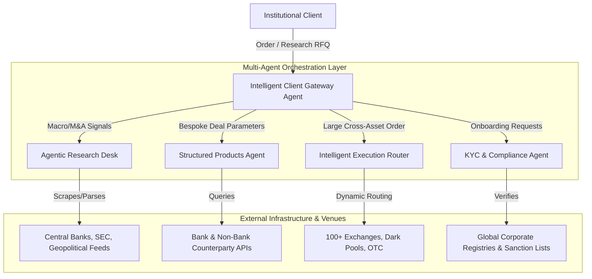
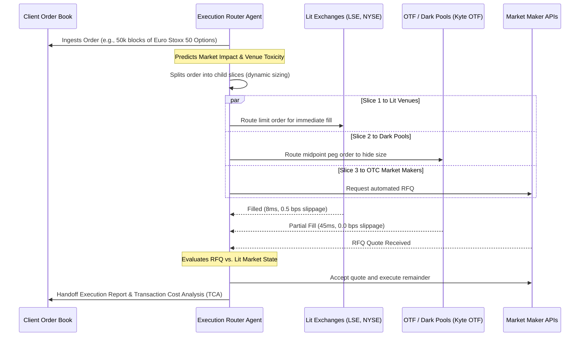

# Agentic AI in Financial Intermediation: Case Studies & Architecture for Market Securities

This document outlines the strategic implementation, technical architectures, and return on investment (ROI) models for deploying **Agentic AI systems** within **Market Securities**. 

Market Securities is one of the largest independent financial intermediaries in the world, settling over **$1T annually**, operating across **100+ execution venues**, and employing **300+ professionals** across **8 global financial centers** (London, New York, Dubai, Geneva, Paris, Hong Kong, Monaco, and Madrid).

---

## Executive Summary: The AI Opportunity in Intermediation

In a high-velocity, cross-asset brokerage environment, value is captured through three pillars: **superior market access (liquidity sourcing)**, **actionable price discovery (commentary/research)**, and **impeccable execution (cost minimization)**. 

Integrating **Agentic AI**—autonomous, goal-driven software entities powered by large language models (LLMs) and deterministic code guardrails—allows Market Securities to scale its operational capacity, enhance execution alpha, and deliver institutional-grade research at near-zero marginal cost.



---

## Use Case 1: Agentic Research & Market Commentary (Macro & Event-Driven Desk)

### 1. Business Context & Challenges
Market Securities' research brand is anchored by world-class macroeconomic commentary (led by Bloomberg top-ranked forecaster Christophe Barraud, PhD) and high-touch Event-Driven / Global Risk Arbitrage desks. 
* **The Challenge**: The sheer volume of macroeconomic data (fiscal updates, monetary minutes, central bank speeches) and event-driven signals (regulatory merger filings, anti-trust reviews, holding company restructurings) is too massive for manual tracking. Important micro-signals can be missed, and drafting high-quality daily commentary is highly labor-intensive.

### 2. Agentic AI Architecture
We deploy a **Collaborative Research Agent Network** consisting of three specialized, autonomous agents:

```
                  ┌──────────────────────────────────────────┐
                  │          Orchestrator Agent              │
                  └────────────────────┬─────────────────────┘
                                       │
         ┌─────────────────────────────┼─────────────────────────────┐
         ▼                             ▼                             ▼
┌──────────────────┐          ┌──────────────────┐          ┌──────────────────┐
│ Central Bank     │          │ M&A Anti-Trust   │          │ Relative Value   │
│ Sentiment Agent  │          │ Arbitrage Agent  │          │ Special Sit Agent│
└────────┬─────────┘          └────────┬─────────┘          └────────┬─────────┘
         │                             │                             │
         └─────────────────────────────┼─────────────────────────────┘
                                       ▼
                  ┌──────────────────────────────────────────┐
                  │        Synthesis & Drafting Agent        │
                  └────────────────────┬─────────────────────┘
                                       ▼
                  ┌──────────────────────────────────────────┐
                  │      Human-in-the-Loop Review (UI)       │
                  └──────────────────────────────────────────┘
```

1. **Central Bank Sentiment Agent**:
   * **Trigger**: Real-time economic data releases or live speech transcripts (Fed, ECB, PBOC, BoE).
   * **Action**: Parses transcripts using semantic classification; runs a deterministic comparison against historical policy stances to detect hawkish/dovish drift; computes a **Policy Shift Index (PSI)**.
2. **M&A Anti-Trust Arbitrage Agent**:
   * **Trigger**: Daily filings on SEC (Edgar), European Commission (Competition), and China's SAMR.
   * **Action**: Extracts conditional deal terms (e.g., break-up fees, regulatory approvals, MAC clauses); performs entity resolution against target databases; assesses political and national security headwinds (CFIUS) using a RAG database of historic blocked deals.
3. **Relative Value & Special Situations Agent**:
   * **Trigger**: Intra-day equity price feeds and corporate action announcements.
   * **Action**: Scans for price discrepancies across share classes, dual-listings, rights issues, spin-offs, and index rebalancing events; alerts the desk with arbitrage spread models.

### 3. Step-by-Step RAG & Synthesis Pipeline
* **PII & Sensitivity Scrubbing**: External data feeds are ingested. Internal research templates and customer subscription profiles are managed securely, keeping proprietary research notes partitioned.
* **Hybrid Retrieval**: Queries combine vector embeddings (conceptual macro themes) and BM25 sparse search (specific ticker symbols, anti-trust case numbers, or economic metrics).
* **Synthesis & Guardrails**: The *Synthesis Agent* drafts the research commentary. Before publication, a **Groundedness Guardrail** checks the draft against the raw source documents:
  $$\text{Groundedness} = \frac{\text{Number of verified sentences in draft}}{\text{Total sentences in draft}}$$
  If the Groundedness score is $< 1.0$, the draft is blocked for potential hallucination and regenerated.

### 4. Business ROI & KPIs
* **Time to Market**: Reduces time-to-draft for morning macro updates from 3 hours to **under 10 minutes** (draft ready for analyst review).
* **Coverage Scope**: Increases the number of monitored global corporate events and M&A transactions by **400%**.
* **Key Performance Indicators**:
  * *Draft Approval Rate*: % of AI-generated research drafts approved by analysts without structural edits (Target: $\ge 85\%$).
  * *SLA Latency*: Processing incoming SEC filings and drafting an impact summary in $< 45\text{ seconds}$.

---

## Use Case 2: Multi-Venue Intelligent Execution Router (IER)

### 1. Business Context & Challenges
Market Securities executes large volumes across equities, fixed income, FX, rates, and commodities. Managing orders across **100+ execution venues** (exchanges, OTC, dark pools, bank and non-bank market makers) requires optimizing bid-ask spreads while minimizing market impact (slippage) and information leakage.
* **The Challenge**: Traditional Smart Order Routers (SORs) rely on static, rule-based trees that fail to adapt to rapid changes in liquidity depth, counterparty response times, and toxic order flow.

### 2. Agentic AI Architecture
We deploy an **Autonomous Execution Agent** based on Reinforcement Learning (RL) and multi-agent coordination.



1. **Liquidity Profiling Agent**:
   * Continuous ingestion of order book feeds (Level 2/3 data) from execution venues.
   * Computes real-time liquidity indicators: **Imbalance metrics**, **spread volatility**, and **depth-of-book decay**.
2. **Venue Toxicity & Fill Rate Predictor**:
   * Learns which counterparties consistently fade their quotes or front-run order flow (information leakage).
   * Models the probability of fill ($P_{\text{fill}}$) as a function of order size, limit price offset, and latency.
3. **Execution Control Agent (The Router)**:
   * Formulates order execution as a Markov Decision Process (MDP).
   * Dynamically adjusts order routing weights to maximize execution speed while minimizing slippage:
     $$\text{Slippage (bps)} = \frac{P_{\text{executed}} - P_{\text{benchmark}}}{P_{\text{benchmark}}} \times 10,000$$

### 3. Deterministic Safety Guardrails
* **Max Market Impact Cap**: If an execution slice is projected to move the mid-price by more than $0.5\%$, the agent triggers a circuit-breaker, shifting the order to passive dark pool pegging.
* **Latency SLA Monitoring**: If API latency on a venue exceeds $150\text{ ms}$, the venue is dynamically blacklisted for $5\text{ minutes}$ to prevent stale-quote executions.

### 4. Business ROI & KPIs
* **Execution Alpha**: Achieves an average slippage reduction of **1.2 to 2.5 basis points (bps)** on large block trades. Across $1T settled, even a 1 bp saving on a fraction of volume equates to millions in client value.
* **Lower Execution Costs**: Automatic routing to lower-cost venues (e.g., internalizing matches on Kyte OTF) saves clearing and exchange fees.
* **Key Performance Indicators**:
  * *Implementation Shortfall (IS)*: Underperforming vs. Arrival Price (Target: $\le 1.8\text{ bps}$).
  * *Market Signaling Rate*: Calculated by tracking price moves in the 5 seconds post-trade (Target: minimal deviation).

---

## Use Case 3: Bespoke Structured Products Engineering & Lifecycle Agent

### 1. Business Context & Challenges
Market Securities has structured product specialists who design primary market investments (equity-linked notes, reverse convertibles, barrier options) and secure secondary market liquidity. 
* **The Challenge**: Structuring a custom note involves manual pricing RFQs across multiple investment banks, backtesting payouts against historical volatility, writing legal term sheets, and running compliance checks (MiFID II target market rules). A single deal can take **2 to 5 days** of manual coordination.

### 2. Agentic AI Architecture
We deploy a **Structured Product Structuring Agent** that coordinates with internal databases and external bank pricing engines.

```
                  ┌──────────────────────────────┐
                  │    Bespoke Client Demand     │
                  │ (Underlying, Yield, Barrier) │
                  └──────────────┬───────────────┘
                                 ▼
                  ┌──────────────────────────────┐
                  │   Structuring Coordinator    │
                  └──────────────┬───────────────┘
                                 │
         ┌───────────────────────┴───────────────────────┐
         ▼                                               ▼
┌──────────────────┐                            ┌──────────────────┐
│ Pricing Engine   │                            │ Legal/Compliance │
│ API Agent        │                            │ Verification     │
└────────┬─────────┘                            └────────┬─────────┘
         │                                               │
         │ (Queries 5+ Banks for pricing)                │ (Validates against MiFID II)
         └───────────────────────┬───────────────────────┘
                                 ▼
                  ┌──────────────────────────────┐
                  │    Monte Carlo Backtesting   │
                  └──────────────┬───────────────┘
                                 ▼
                  ┌──────────────────────────────┐
                  │ Automated Term Sheet Draft   │
                  └──────────────────────────────┘
```

1. **Parameters Collector Agent**:
   * Parses client emails or structured chat requests (e.g., *"We need an autocallable note on Euro Stoxx 50, 1-year duration, 90% capital protection, looking for an 8% coupon"*).
2. **Pricing Engine Broker Agent**:
   * Connects via secure REST APIs to major issuing banks (e.g., Goldman Sachs, BNP Paribas, SG).
   * Runs automated RFQs to gather pricing terms for the derivative legs (zero-coupon bond + option overlay).
3. **Compliance & Legal Guardrail Agent**:
   * Evaluates the proposed payoff structure against MiFID II Target Market criteria.
   * Automatically drafts the **Key Information Document (KID)** and Term Sheet by injecting structured pricing output into approved templates.
4. **Secondary Market Liquidity Monitor**:
   * Once the product is live, this agent monitors secondary market valuations.
   * If the bid-ask spread offered by the issuer widens beyond pre-agreed limits, the agent alerts the trading desk to execute offsetting hedges or negotiate with the issuer.

### 3. Business ROI & KPIs
* **Deal Velocity**: Reduces time-to-client for structured note proposals from **3 days to 15 minutes**.
* **Increased Volume**: Enables structuring desks to handle **10x more RFQs** without increasing head count.
* **Key Performance Indicators**:
  * *RFQ Conversion Rate*: % of structured product quotes accepted by buy-side clients.
  * *Error-Free Rate*: % of automatically generated KIDs/Term Sheets passing final human legal audit without corrections (Target: $\ge 98\%$).

---

## Use Case 4: Client Onboarding KYC/AML & OTF Compliance Agent

### 1. Business Context & Challenges
Operating an Organised Trading Facility (OTF) and trading globally requires rigorous **Know Your Customer (KYC)**, **Anti-Money Laundering (AML)**, and regulatory compliance. 
* **The Challenge**: Onboarding institutional clients (hedge funds, asset managers, corporate treasuries) across multiple jurisdictions is slow. Compliance analysts must manually verify corporate hierarchies, map Ultimate Beneficial Owners (UBOs), screen for Politically Exposed Persons (PEPs), and check adverse media. This creates operational bottlenecks and delays revenue generation.

### 2. Agentic AI Architecture
We implement a **Three-Tiered Intelligent Compliance Agent** that parses legal documents, maps ownership structures, and flags regulatory risks.

```
                      [ Client Ingest Documents ]
                       (PDFs, Corporate Registers)
                                    │
                                    ▼
                      ┌───────────────────────────┐
                      │    Entity Resolution &    │
                      │      UBO Extraction       │
                      └─────────────┬─────────────┘
                                    │
                                    ▼
                      ┌───────────────────────────┐
                      │    Adverse Media & PEP    │
                      │      RAG Verification     │
                      └─────────────┬─────────────┘
                                    │
                     [ Confidence Score & Risk ]
                                    │
            ┌───────────────────────┴───────────────────────┐
            ▼                                               ▼
   [ Low-Risk / High Confidence ]                [ High-Risk / Low Confidence ]
         (Score >= 0.92)                                 (Score < 0.92)
            │                                               │
            ▼                                               ▼
     [ Auto-Approval ]                            [ Route to HITL Queue ]
  Direct to CRM & Trading Platform               Detailed Audit Trail + Summary
```

1. **Entity Extraction & Resolution Agent**:
   * Ingests registry filings, articles of association, and organizational charts.
   * Extracts entity names, incorporation numbers, addresses, and directors.
   * Builds an ownership graph to trace UBOs down to the $\ge 10\%$ threshold.
2. **Sanctions & Adverse Media Screener Agent**:
   * Performs semantic searches across global sanctions lists (OFAC, EU, UK HMT) and news databases.
   * Uses an **LLM-as-a-Judge** to classify media sentiment and filter out false positives (e.g., matching a client to an unrelated person with a similar name).
3. **Audit Trail Generator Agent**:
   * For every decision, the system compiles a **Deterministic Trace Envelope**:

> [!NOTE]
> **Deterministic Trace Envelope (Audit Trail)**
> * **Trace ID**: `tx_kyc_2026_88301`
> * **Client**: `Aegis Global Fund Ltd` (Incorporated: Cayman Islands, Reg: #38829)
> * **UBO Identified**: `Marcus Vance` (Nationality: UK, holding 28% shares via intermediate shell `Vance Holdings LLC`).
> * **Sanction Screening Status**: PASS. No exact or fuzzy matches found in OFAC/EU lists.
> * **Adverse Media Status**: WARNING. Found 2 articles mentioning litigation. Classifying model evaluated the litigation as standard commercial dispute, not AML/fraud related (Confidence: $0.94$).
> * **Triage Decision**: Routed to **HITL Compliance Officer** due to Cayman Islands jurisdiction and adverse media warning.

### 3. Business ROI & KPIs
* **Onboarding Speed**: Reduces institutional customer onboarding cycle times from **5 days to 20 minutes** for low-risk files.
* **Compliance Efficiency**: Compliance analysts spend their time auditing flagged risk cases rather than manually searching registries.
* **Key Performance Indicators**:
  * *False Positive Reduction*: % reduction in irrelevant AML name-match flags (Target: $\ge 70\%$).
  * *Regulatory Compliance Audit Rate*: 100% trace coverage for internal and external (FCA/MiFID II) regulatory audits.

---

## Technical & Safety Guardrails Summary

To ensure safe production deployment of these use cases across Market Securities' trading and research infrastructure, the following guardrails must be continuously monitored:

| Guardrail Layer | Target Threshold / SLA | Primary Failure Mitigation |
| :--- | :--- | :--- |
| **Groundedness Guardrail** (Research) | $1.00$ (Zero Hallucination) | Block generation, fall back to historical templates, and alert analyst. |
| **Execution Latency SLA** (IER) | $< 150 \text{ ms}$ (95th Pctl) | Trip venue circuit-breaker; route orders to alternative market makers. |
| **Market Impact Threshold** (IER) | Max $0.50\%$ Price Impact | Dynamic size reduction; pause execution slices or route to dark pools. |
| **UBO Resolution Confidence** (KYC) | $\ge 0.92$ | Route to Human-in-the-Loop (HITL) compliance analyst queue with summary. |
| **Data Encryption SLA** | AES-256-GCM / SOC2 | Block data transit if compliance envelopes or tokens fail verification. |

---

## Conclusion & Implementation Strategy

Implementing Agentic AI at Market Securities should follow a phased approach:

1. **Phase 1 (Month 1-3) - Ingestion & Research Enhancement**: Deploy the *Agentic Research & Market Commentary* pipeline. This carries low execution risk and yields high immediate efficiency gains for the research desks.
2. **Phase 2 (Month 3-6) - KYC & Structured Products**: Integrate the *Compliance and KYC* extraction agents and the *Structured Products RFQ coordinator*. These automate intensive document-heavy workflows and interface with pricing APIs.
3. **Phase 3 (Month 6-12) - Intelligent Execution Routing**: Deploy the *Intelligent Execution Router (IER)* on liquid equities and FX, gradually expanding to complex derivatives and illiquid credit pools as the RL models optimize.
