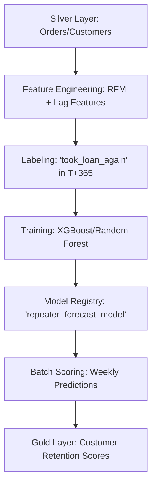

# Loan Forecasting Architecture: Predicting Repeat Borrowers

This module focuses on **Retention Forecasting**. While the Risk Model predicts *if* a user will pay back, this model predicts *when* and *if* a user will take another loan in the next 12 months.

## 1. Business Objective
- **Goal**: Predict the probability of each customer taking a repeat loan (order) within the next 365 days.
- **Value**: 
    - Marketing can target users with low probability of return with discounts.
    - Finance can forecast future loan book growth.
    - Risk can adjust credit limits for high-frequency reliable borrowers.

## 2. Methodology: RFM Analysis + Machine Learning
To predict future behavior, we use **RFM (Recency, Frequency, Monetary)** features:
- **Recency**: Days since last loan.
- **Frequency**: How many loans taken in the last year.
- **Monetary**: Average loan amount.
- **Engagement**: Tenure (how long they've been with Postpay).

## 3. Data Pipeline

## 4. Key Metrics
- **Recall**: Crucial if we want to ensure we don't miss potential returning customers.
- **Precision**: Important to avoid over-spending marketing budget on users who would have returned anyway.
- **Conversion Rate Forecast**: The sum of probabilities gives the expected number of loans.

**During Gradient Descent optimization, what is the most likely consequence of setting the learning rate hyperparameter too high?**

Real-World Example: Finding the Bottom of a Valley Blindfolded
Imagine you are blindfolded in a mountain range, and your goal is to find the absolute lowest point in the valley. You can only figure out where to go by feeling the slope of the ground with your feet.

A Tiny Learning Rate (Baby Steps): You take 1-inch shuffles down the slope. You will absolutely reach the bottom safely, but it might take you weeks to get there. (This takes too much computational time).
A Good Learning Rate (Walking): You take normal, confident strides down the slope. As it flattens out, you take slightly smaller steps until you stand perfectly at the lowest point.
A TOO HIGH Learning Rate (The Catapult): Your "step size" is equivalent to getting shot out of a cannon. You feel the ground sloping downward to your right, so you launch yourself 5 miles in that direction. Because your step was so massive, you completely overshoot the bottom of the valley and land halfway up the side of the opposite mountain!
Realizing you went too far, you feel the slope pointing back to the left, so you launch yourself 6 miles back the other way. You are now violently bouncing back and forth between the mountain peaks, getting higher and higher, completely failing to settle at the peaceful bottom of the valley. This is exactly what your neural network's loss function does when the learning rate is set too high!

**What is the fundamental purpose of the "kernel trick" in Support Vector Machines (SVM)?**

To map data into a higher-dimensional space where it becomes linearly separable, without explicitly calculating the new coordinates.

**Why is the Naive Bayes classifier structurally described as "naive"**

The Naive Bayes Classifier is a simple, fast, and highly effective machine learning algorithm used primarily for classification tasks (like grouping data into categories). It is built heavily on Bayes' Theorem from statistics, which calculates probability based on prior knowledge.

"Based on the historical data I have seen in the past, what is the probability that this new data belongs to Class A versus Class B?"

For example, if you are building an email spam filter:

The model looks at an incoming email containing the words "Free," "Money," and "Winner."
It calculates: "What is the probability this is Spam given that it contains these exact words, compared to the probability that it is a Normal email?" Whichever probability is higher is the class it chooses.

The algorithm is called "Naive" because it makes a massive, very unrealistic assumption: It assumes that every single feature being evaluated is completely independent of every other feature

**Why are Convolutional Neural Networks (CNNs) drastically more efficient than Multi-Layer Perceptrons (MLPs) when processing high-resolution image data?**

CNNs employ parameter sharing and local connectivity via sliding convolutional filters.

 In a traditional MLP, every single input pixel must be connected to every single neuron in the first layer. Imagine you have a relatively small high-resolution image that is 1,000 x 1,000 pixels. That is 1,000,000 total pixels. If your first neural network layer has just 1,000 neurons, an MLP requires calculating 1 billion different weights (1,000,000 pixels × 1,000 neurons) just for that single layer! This requires massive computational power,

 The CNN Solution (Convolutional Filters): CNNs solve this geometry problem in two brilliant ways:

Local Connectivity: Instead of forcing a neuron to look at the entire 1,000,000-pixel image at once, a CNN uses a small "filter" (like a magnifying glass) that only looks at a tiny patch of the image at a time—usually a 3x3 or 5x5 grid of pixels. It scans for simple, local patterns like a sharp edge or a color gradient.

Parameter Sharing: Because a vertical edge in the top-left corner of an image is the exact same visual pattern as a vertical edge in the bottom-right corner, the CNN uses the exact same 3x3 filter (which only has 9 weights) and slides it across the entire image.

Instead of an MLP trying to learn 1 billion unique, disconnected weights, the CNN might only need to learn 9 weights for a filter, and it just shares those same 9 weights across the whole image. This drastically reduces the computational load and makes CNNs incredibly fast and accurate at processing images.

**In time-series analysis, what does it mean if a dataset is confirmed to be "stationary"?**

Its statistical properties, such as mean, variance, and autocorrelation, remain constant over time.

**PCA**

When you are trying to predict driver risk (e.g., the likelihood of a driver getting into an accident or filing an insurance claim), you often collect "telematics" data from GPS or car sensors.

Imagine your dataset has 30 different raw features for every driver, including:

Number of hard braking events per week
Number of rapid accelerations per week
Average speed over the speed limit
Total miles driven between 12 AM and 4 AM (Night driving)
Total miles driven during rush hour traffic
Total annual mileage
Frequency of hard cornering (taking turns too fast) ...and 23 other data points.
Feeding all 30 of these raw features into a machine learning model is inefficient. Many of these variables are highly correlated (meaning they basically tell the model the exact same thing). PCA is the perfect tool to clean this up.

Here is exactly how PCA processes your driver risk data:

Step 1: Standardization
First, PCA scales the data. "Total annual mileage" might be 15,000, while "Hard braking events" might be 4. If you don't standardize, the model will think annual mileage is more important just because the number is bigger. PCA levels the playing field so every metric is treated equally.

Step 2: Finding PC1 (The Biggest Source of Risk)
PCA looks at all 30 columns and asks: "Where is the biggest mathematical difference (variance) between all these drivers?"

It notices that drivers who have high "hard braking" also tend to have high "rapid accelerations," "hard cornering," and "speeding." Because these four features always move up and down together, they are basically telling the exact same story.

PCA mathematically crushes these four features together into a single, brand-new variable. We will call this Principal Component 1 (PC1).

Human Translation of PC1: You can think of PC1 as the "Aggressive Driving Score."
By combining them, PC1 alone might capture 40% of the total variance in your entire dataset!
Step 3: Finding PC2 (The Next Biggest Source of Risk)
Now PCA looks for the second biggest pattern in the data. The golden rule of PCA is that PC2 must be completely independent (orthogonal) to PC1. It cannot be related to "aggressive driving."

It searches the remaining data and notices that "Night driving," "Rush hour driving," and "Total annual mileage" tend to group together. A driver might be a very safe, cautious driver (low PC1), but they drive 30,000 miles a year, mostly at 2 AM.

PCA combines these into Principal Component 2 (PC2).

Human Translation of PC2: You can think of PC2 as the "Environmental Exposure / Time-on-Road Score."
Step 4: Finding PC3, PC4... and Dropping the Rest
PCA keeps doing this, extracting smaller and smaller patterns (PC3 might capture "Weather-related risk", etc.).

By the time it gets to PC15 through PC30, it is just looking at random, useless noise—like whether the driver turned the radio volume up on a Tuesday. This noise actually confuses machine learning models and causes overfitting.

The Final Result for Your Model
Instead of training your Driver Risk model on 30 messy, overlapping features, you tell PCA to only give you the Top 5 Principal Components.

The Benefit:

Speed & Efficiency: Your dataset is now drastically smaller (5 columns instead of 30).
Eliminated Overlap (Multicollinearity): Because every Principal Component is completely independent of the others, your model won't get confused by overlapping data.
Preserved Information: Even though you deleted 25 columns, because PCA specifically targeted the axes of maximum variance, those 5 columns still contain 95% of the actual, predictive information about what makes a driver risky!